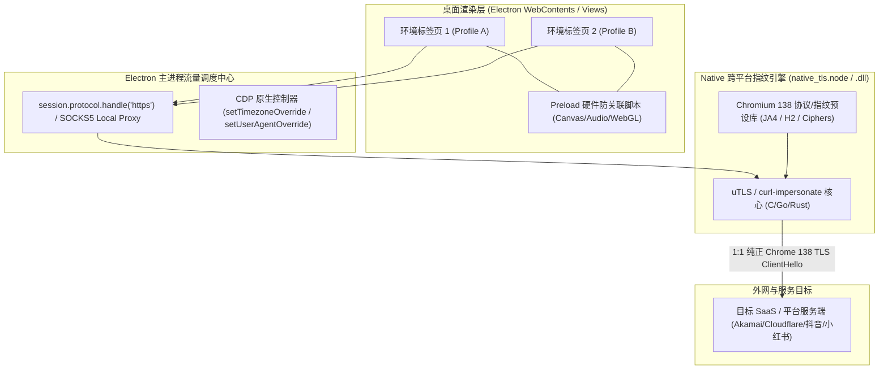
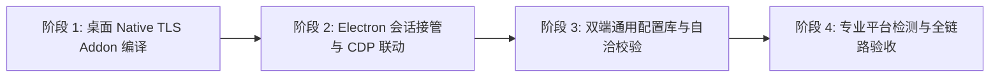

# 全谱系指纹适配与双端 TLS/JSAPI 自洽架构规划方案（桌面客户端）

> **文档状态**：实施规划中（Architecture & Development Blueprint）  
> **制定日期**：2026-11-04  
> **适用项目**：`electron.fingerprint`（PC 桌面客户端）  
> **协同项目**：`electron.mobile`（移动端跨端容器）、`saas-server`（云端协同中心）  
> **核心基线**：**默认基线对齐 Chromium 138**，实现 **“网络传输层（TLS/H2）与页面执行层（JSAPI/DOM）100% 物理级逻辑自洽”**。

---

## 一、 架构背景与桌面端核心痛点

### 1.1 现状与挑战
`electron.fingerprint` 是 SaaS 系统的桌面端核心工作台底座，负责桌面端环境隔离、指纹定制与自动化调度。在过去的架构中，桌面端主要采用 **Chromium C++ 源码级 Patch**（如在 `fp-kernel` 中维护针对 BoringSSL、`net/socket`、Navigator、Canvas、WebGL 的 `.patch` 补丁文件，通过 Ninja 编译定制化 Electron 二进制）。

这种传统的源码 Patch 模式在长期的迭代与维护中暴露出明显的瓶颈：
1. **升级与维护成本极高**：每次升级 Chrome 大版本（如从 Chrome 120 升级至 138），均需重新拉取百 GB 源码并重写 C++ Patch，单次本地/CI 编译耗时数小时，极其沉重；
2. **多 Profile 动态混跑受限**：Chromium 的 NetworkService 与 BoringSSL 会话在主进程层面具有较强的单例复用倾向，在同一个客户端内让不同标签页实时动态切换完全不同的 TLS 密码套件与 JA4 算法难度极大；
3. **双端指纹特征分裂**：PC 桌面端走 C++ 编译，移动端走 Java/WebView，两端底层 TLS 握手特征与 JSAPI 参数缺乏统一的跨平台协议标准，极易出现指纹特征不自洽。

### 1.2 破局之道：底层 C++ 内核深度掌握，实施“138 保持原生 + 跨版本内核级精准适配”双轨模式
**明确核心原则：桌面端沉淀的 `fp-kernel` C++ 原生能力是项目的核心壁垒，第一目标是绝对不留任何可被网站检测的路径和痕迹！**
桌面端原生 C++ Patch 直接在 Blink 内部修改了 Canvas、WebGL、Navigator、Screen、Locale 等，由于直接运行在 C++ 引擎内部，没有任何 JS 劫持/原型链篡改的痕迹，具备业界最高等级的抗检测性。

针对 TLS/网络层伪装，桌面端**坚决不在应用层引入本地回环代理（Loopback Proxy）或 `protocol.handle` 伪装**（防止被目标网页通过 WebSocket/Fetch 探测 `127.0.0.1` 开放端口，或因时序抖动留下风控破绽）。桌面端实施 **“纯 C++ 内核级无痕网络适配”**：
- **Chrome 138 主流基线（保持现有原生直通）**：桌面内核本身即为正规 Chromium 138（`138.0.7204.185`），默认直接走 Chromium 官方原生 BoringSSL 网络栈发包（天然包含 ML-KEM-768 抗量子协商、新版 ALPS 17613、RFC 8701 GREASE 与 HTTP/2 标准帧）。零额外逻辑干预、零性能损耗、零风控破绽；
- **非 138 跨版本模拟（内核级精准适配）**：当且仅当环境显式声明模拟 Chrome 120、124、126 等旧版本时，通过底层 Mojo (`ssl_config.mojom`) 将经审计的旧版算法拓扑下发至网络进程 `SSLClientSocketImpl` 与 `BoringSSL`（动态关闭后量子协商、切换回经典椭圆曲线 `[29, 23, 24]`、回退 ALPS 17513），彻底消除 UA 与底层网络特征分裂的致命矛盾。

---

## 二、 核心原则：双端同构与 100% 物理自洽

本项目与移动端 [`electron.mobile`](file:///f:/mywork/electron.mobile) 共同确立以下核心铁律：

### 2.1 铁律一：双端指纹模型同构性（Cross-Platform Consistency）
桌面端与移动端使用完全一致的 `FingerprintProfile` 格式。无论是在 Windows、macOS 还是 Android 设备上启动同一套指纹配置，其生成的 TLS ClientHello 字节序、HTTP/2 协议帧参数、HTTP 请求标头以及 DOM 环境变量必须**保持严格一致**。

### 2.2 铁律二：默认基准版本锁定为 Chromium 138
双端默认出厂基准全部对齐 **Chromium 138（2025/2026 最新主流内核规范）**。
- 严禁出现桌面端用 Chrome 138 而移动端用 Chrome 120 的脱节现象；
- 所有相关协议规范（如 TLS 1.3 Kyber 768 抗量子混合群、`zstd` 压缩流、Client Hints 格式、RFC 8701 GREASE 扩展）必须基于 Chrome 138 标准实现。

### 2.3 铁律三：全维度立体自洽矩阵（Zero Contradiction）
指纹特征绝不能互相矛盾，必须在全谱系 5 个物理层级上实现逻辑闭环：

| 指纹层级 | 物理归属 | 桌面端承接技术 | Chrome 138 桌面预设自洽标准 |
| :--- | :--- | :--- | :--- |
| **Layer 1: TLS 握手** | 传输层 (L4) | `SSLClientSocketImpl` / BoringSSL 原生内核 | 包含 ML-KEM-768/Kyber、ALPN (`h2,http/1.1`)、GREASE 混淆、JA4 严格吻合 Chrome 138 |
| **Layer 2: HTTP/2 帧** | 协议层 (L7) | Chromium `net/spdy` 原生网络栈 | SETTINGS 帧（65536, 6291456 等）、伪头顺序严格为 `[:method, :authority, :scheme, :path]` |
| **Layer 3: HTTP 标头** | 语法层 (L7) | Chromium 原生请求生成 | `Accept-Encoding: gzip, deflate, br, zstd`；`sec-ch-ua` 携带 138 主版本号 |
| **Layer 4: JS & DOM** | 渲染层 (DOM) | `fp-kernel` C++ 原生补丁（主干）+ CDP 覆盖 | `navigator.userAgentData`、`platform: "Win32"`、时区、语言由 Blink/V8 底层原生返回，零 JS 篡改痕迹 |
| **Layer 5: 硬件与图形** | 硬件层 (API) | `fp-kernel` C++ 原生补丁 (Skia/Blink 内部注入) | Canvas 噪点在 C++ 内部生成、WebGL 真实替换为 NVIDIA RTX 4080、AudioContext 原生微扰 |

---

## 三、 桌面端总体技术架构设计

在桌面端，Electron 主进程天然拥有 Node.js 与底层操作系统权限，可采用极高性能的内存级协议拦截或本地 Loopback 代理：



### 3.1 核心组件实现方式

1. **Native 跨平台 TLS 模块 (`native_tls.node` / `.dll`)**：
   - 使用与移动端完全一致的 C 语言（`curl-impersonate`）或 Go（`uTLS`）核心源码，在 Windows/macOS 上编译为 Node.js 原生扩展（N-API）；
   - 负责 1:1 发送与真实 Chrome 138 无任何二致的 ClientHello 报文，完全屏蔽 Electron 自身的静态握手特征；
   - 保证 HTTP/2 协议参数、流控制、头部压缩与 Chrome 138 像素级对齐。
2. **流量接管与会话管理器 (`SessionNetworkRouter.ts`)**：
   - 方案 A（协议级流式接管）：通过 `session.protocol.handle('https', ...)` 拦截 HTTPS 请求并交由 Native 模块抓取响应流返回，进程内直通，零端口暴露；
   - 方案 B（本地 Loopback 回环代理）：通过 `session.setProxy({ proxyRules: 'socks5://127.0.0.1:port' })` 接管包括 WebSocket 在内的全量流量。
3. **CDP 原生无痕环境注入器 (`CdpFingerprintController.ts`)**：
   - 利用 Electron `webContents.debugger` 原生调用 CDP 指令：
     - `Emulation.setTimezoneOverride({ timezoneId })`：底层 V8 / ICU 原生重定向时区，零 JS Hook 破绽；
     - `Network.setUserAgentOverride(...)`：底层原生同步 `navigator.userAgent` 与 Client Hints 高阶熵值；
   - 通过 `--lang=...` 命令行开关原生同步语言与区域设置。
4. **`fp-kernel` C++ 原生底层指纹引擎（一级核心基石，坚决保留）**：
   - 桌面端已在 Blink、Skia 与 V8 内部实现的 Canvas 噪点注入、WebGL 真实替换、Navigator 属性与 ICU 时区的 C++ 补丁属于项目的核心技术资产；
   - 此机制在浏览器内核源码层生效，具有最高级别的抗反作弊能力（页面脚本探测不到任何 JS Hook 痕迹）；
   - 在新架构中，**`fp-kernel` 原生 C++ 指纹管线作为默认优先执行的一级引擎（Tier-1 Engine）**，与网络层 Native TLS 形成最强双核组合。Preload 注入脚本仅作为跨平台兼容或动态热补丁的补充保底。

---

## 四、 实施计划与里程碑 (Milestones)



### 阶段 1：桌面 Native TLS 模块编译与协议预设固化
- **工作目标**：编译出高性能的 Windows/macOS 桌面原生 Node Addon，支持毫秒级发起 Chrome 138 协议握手。
- **具体任务**：
  1. 使用 CMake / node-gyp 交叉编译 `curl-impersonate` / `uTLS` 核心，生成 `native_tls.node`；
  2. 内置并固化 **Chromium 138** 默认指纹预设（包含 Kyber768 抗量子密码算法、GREASE 混淆、Chrome 138 密码套件与扩展排列）；
  3. 编写单测程序，请求 Cloudflare / Akamai 探针接口，抓包验证 ClientHello 字节序与 JA4 哈希达到 100% 吻合。

### 阶段 2：Electron 会话协议接管与 CDP 原生注入
- **工作目标**：在桌面端主进程中打通 Profile 会话接管，杜绝任何未经伪装的裸网络流量泄漏。
- **具体任务**：
  1. 实现 `SessionNetworkRouter.ts`，为每个环境分配独立的隔离 Session，并挂载协议处理器；
  2. 实现基于 CDP 的时区与语言原生覆盖，确保 `new Date()` 与 `Intl` 绝不暴露宿主 PC 真实时区；
  3. 实现与现有 Cookie 存储（SQLite / LevelDB）的双向流式同步，保持用户登录态稳定；
  4. 整合 Preload Canvas 2D 噪点与 WebGL 硬件模拟，确保 `Function.prototype.toString` 输出原生代码。

### 阶段 3：双端 Profile 契约对齐与自洽校验引擎
- **工作目标**：与移动端工程落地完全相同的 `FingerprintProfile` 格式，并增加动态自洽校验门禁。
- **具体任务**：
  1. 在 `fingerprint-browser` 中引入统一的 `fingerprint-profile.json` 模式（见第五节）；
  2. 实现自洽性防呆断言检查（Consistency Validator）：
     - 若 Profile 为 Windows Desktop，检查 TLS 必须为 Windows 预设，平台必须为 `Win32`，禁止出现移动端 Adreno 显卡或触摸点；
     - 若标头声明了 Chrome 138，检查 Client Hints 与 TLS Kyber 算法必须同步激活；
  3. 支持动态切换 Profile，无需重启应用即可在不同标签页之间实现多指纹共存。

### 阶段 4：专业防探测门禁校验与双端端到端联调
- **工作目标**：在全套主流防作弊探针下达到 95% 以上高信任分，并与 SaaS 业务端完全跑通。
- **具体任务**：
  1. 访问 [CreepJS](https://abrahamjuliot.github.io/creepjs/)：
     - 确保信任评分（Trust Score）在 90% 以上；
     - 确保无 `Lies` 警告，无原型链污染与 CDP 泄漏特征；
  2. 访问 [BrowserLeaks](https://browserleaks.com/)、[IPhey](https://iphey.com/)、[Pixelscan](https://pixelscan.net/)：
     - 验证 JA3/JA4 哈希与官方 Chrome 138 真实客户端完全重合；
     - 验证 HTTP/2 SETTINGS 帧、`zstd` 标头、Canvas/WebGL 一致性；
  3. 与移动端 `electron.mobile` 端到端对比，保证两端连接同一检测接口时输出的指标完全对称一致。

---

## 五、 统一指纹配置规范（双端通用 JSON 契约）

桌面端与移动端严格共享下述配置模式，实现配置文件的双端无缝互通：

```json
{
  "version": "2.0.0",
  "baseEngine": "Chromium 138.0.7204.0",
  "profileId": "env_profile_desktop_01",
  "network": {
    "tlsPreset": "chrome_138_windows",
    "http2Settings": {
      "headerTableSize": 65536,
      "enablePush": 0,
      "maxConcurrentStreams": 1000,
      "initialWindowSize": 6291456,
      "maxFrameSize": 16384,
      "maxHeaderListSize": 262144
    },
    "acceptEncoding": "gzip, deflate, br, zstd"
  },
  "runtime": {
    "userAgent": "Mozilla/5.0 (Windows NT 10.0; Win64; x64) AppleWebKit/537.36 (KHTML, like Gecko) Chrome/138.0.0.0 Safari/537.36",
    "platform": "Win32",
    "clientHints": {
      "brands": [
        { "brand": "Chromium", "version": "138" },
        { "brand": "Google Chrome", "version": "138" },
        { "brand": "Not=A?Brand", "version": "24" }
      ],
      "mobile": false,
      "platform": "Windows",
      "architecture": "x86",
      "bitness": "64"
    },
    "screen": {
      "width": 1920,
      "height": 1080,
      "devicePixelRatio": 1.0,
      "colorDepth": 24
    },
    "hardware": {
      "cpuCores": 16,
      "deviceMemory": 32,
      "maxTouchPoints": 0
    },
    "webgl": {
      "vendor": "Google Inc. (NVIDIA)",
      "renderer": "ANGLE (NVIDIA, NVIDIA GeForce RTX 4080 Direct3D11 vs_5_0 ps_5_0, D3D11)"
    },
    "locale": {
      "language": "zh-CN",
      "languages": ["zh-CN", "zh"],
      "timezone": "Asia/Shanghai"
    },
    "noise": {
      "canvasNoiseSeed": 4829104,
      "audioNoiseEnabled": true
    }
  }
}
```

---

## 六、 结论与后续实施指南

本方案确立了桌面端“底层 C++ 内核源码级 TLS 适配（BoringSSL / Mojo）+ Blink/Skia 原生环境防伪装”的技术路线，杜绝了在桌面端搞应用层拦截/代理带来的检测靶点。同时实现了 Chrome 138 原生直通与非 138 跨版本精准定向适配。

- **文档归档路径**：`electron.fingerprint/docs/FULL_SPECTRUM_FINGERPRINT_AND_TLS_ALIGNMENT_PLAN.md`
- **协同实施建议**：桌面端保持 Chromium 138 原生网络栈直通，仅在用户显式需要模拟旧版本时走跨版本内核适配；移动端继续使用轻量 Native TLS 拦截，双端在配置契约与风控指标上对齐。

---

## 七、 支持的 UA 版本与操作系统版本说明（Compatibility Matrix）

### 7.1 浏览器及 UA 版本支持范围与策略

| 版本区间 / 目标版本 | 归属模式 | TLS 椭圆曲线与密钥协商 | ALPS 标识 | 后量子协商 (PQ) | ECH 支持 | 对齐说明 |
| :--- | :--- | :--- | :--- | :--- | :--- | :--- |
| **Chrome 138（默认基线）**<br>`138.0.7204.185` | **原生直通 (native)** | ML-KEM-768 (`4588`)、X25519、P-256、P-384 | `17613` (新版) | 开启 (`true`) | 开启 (`true`) | 桌面内核原生基准版本，官方网络栈天然发包，零伪装干预，JA4 完美匹配官方 Chrome 138。 |
| **Chrome 131 ~ 137** | **自适应跨版本 (cross-version)** | ML-KEM-768 (`4588`)、X25519、P-256、P-384 | `17613` (新版) | 开启 (`true`) | 开启 (`true`) | 对齐 Chrome 131+ 正式引入的 ML-KEM-768 标准混合群与新版 ALPS。 |
| **Chrome 124 ~ 130**<br>(预设含 124, 126, 128, 130) | **定向跨版本 (cross-version)** | Kyber-768 草案 (`25497`)、X25519、P-256、P-384 | `17513` (旧版) | 开启 (`true`) | 开启 (`true`) | 对齐 Chrome 124~130 阶段引入的草案后量子算法及过渡期特征。 |
| **Chrome 120 及更早 (< 124)**<br>(支持下探至 Chrome 100) | **经典跨版本 (cross-version)** | 纯经典曲线 `[29, 23, 24]`<br>(X25519, P-256, P-384) | `17513` (旧版) | **强制关闭 (`false`)** | **禁用 (`false`)** | 彻底移除后量子特征与 ECH，完全模拟后量子诞生前的经典 Chrome 客户端握手。 |

- **版本合法性校验区间**：系统校验门禁支持 `Chrome 100` 至 `Chrome 200` 大版本范围，拒绝非法、畸形或跨生态版本拼凑；
- **自洽审查保护**：若 UA 声明为 Chrome 120，但未配置跨版本策略，系统会自动触发告警并阻止将 Chrome 138 的后量子算法泄露给目标网站。

### 7.2 操作系统（OS）与平台支持范围

| 操作系统平台 | 内部标识 (`platform`) | 标准 User-Agent 片段 | 硬件显卡推荐自洽标准 | 架构支持 |
| :--- | :--- | :--- | :--- | :--- |
| **Windows 10 / 11** | `Win32` | `Mozilla/5.0 (Windows NT 10.0; Win64; x64) ...` | ANGLE (NVIDIA / Intel / AMD Direct3D11) | x86_64 |
| **macOS (Catalina ~ Sequoia)** | `MacIntel` | `Mozilla/5.0 (Macintosh; Intel Mac OS X 10_15_7) ...` | ANGLE (Apple, Apple M1/M2/M3 Metal) | x86_64 / arm64 |
| **Linux (主流发行版)** | `Linux x86_64` | `Mozilla/5.0 (X11; Linux x86_64) ...` | Mesa / OpenGL 驱动拓扑 | x86_64 |

#### 宿主物理防伪装铁律（平台防穿透约束）：
1. **桌面宿主相容原则**：桌面客户端严禁在 Windows/macOS 宿主上伪装为移动端（`Android` 或 `iOS`）。
   - 风控反爬系统通过字体渲染度量（Font Metrics）、系统物理调用、Client Hints 高阶熵值、屏幕触摸点数能够 100% 识破“在 PC 上伪造 Android UA”的拙劣伪装；
2. **双端协同边界**：
   - 移动端流量及真实 Android / 鸿蒙设备特征，由专属的移动端容器（`electron.mobile`）负责承接；
   - 桌面端（`electron.fingerprint`）专职承接高保真桌面级平台账号运营与自动化，实现“PC 归 PC，移动归移动，全维度立体自洽”。