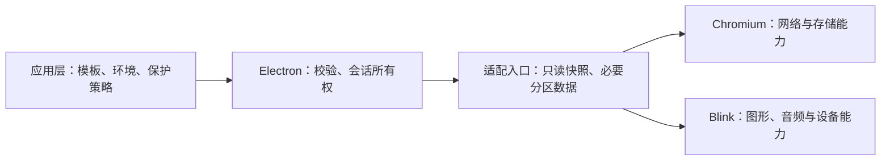

# 主流指纹浏览器技术分析与指纹强化、防追踪关联开发计划

编制日期：2026-10-11。适用项目：栖界指纹浏览器 / electron.fp。

本文交付技术决策、开发任务和验收门槛，不代表已实现新能力。竞品结论来自本次查阅的官方资料；项目结论来自当前源码、补丁、构建副本的只读核查及历史验证记录。未安装和实测竞品，不做防关联效果排名；选取八个代表性产品，不据此宣称市场份额排名。

## 1. 建议采用的路线

下一步以“真实能力约束下的一致性 + 环境隔离 + 站点分区 + 网络泄漏防护”为主线。先把现有保护做成可验证的产品能力，再补 WebGPU 等新增表面。

优先级顺序：

1. 固化现有发行包证据、有效保护范围和旧环境迁移行为。
2. 验证并补齐代理失败阻断、WebRTC、DNS、IPv6 和后台请求边界。
3. 验证环境间存储隔离、同一环境内的跨站存储及网络状态分区。
4. 将环境级固定扰动升级为具有明确站点边界的保护，并处理音频固定偏移的可恢复风险。
5. 补齐 WebGPU、字体、媒体设备等剩余表面，完成组合兼容性验收。

工程目标是降低可直接关联的信号、限制真实设备信息暴露、保留站点功能。检测页通过率、跨站关联能力、环境隔离和使用兼容性分别报告。

## 2. 市面主流产品：公开技术路线与可借鉴点

下表“公开能力”只表示官方提供或宣称的配置能力，不证明其算法、网络实际路径或对闭源风控的效果。资料查询时间均为本次编制日期。

| 产品 | 官方公开的技术路线与能力 | 可借鉴点 | 尚不能据资料确认 |
| --- | --- | --- | --- |
| Multilogin | Mimic 为持续维护的 Chrome 系内核；官方将 Stealthfox 列为旧版选项。提供图形、字体、网络等配置；Canvas 默认真实输出，也可使用持久噪声 | 优先参数一致性，不要求每个指纹值都独一无二；明确跨机器迁移会改变部分渲染结果 | 具体噪声算法、所有 Worker 路径和实际 WebRTC 防泄漏效果。来源：[指纹设置](https://multilogin.com/help/profile-settings-fingerprint-section)、[内核选项](https://multilogin.org/help/en_US/how-to-use-mimic-and-stealthfox) |
| GoLogin | Orbita 基于 Chromium；提供 Canvas、WebGL、AudioContext、ClientRects 等控制，强调环境内稳定和图形噪声 | 内核实现与完整环境配置结合；创建后维护身份稳定，迁移时检查真实宿主能力 | 噪声统计分布、跨站分区策略和跨设备输出稳定性。来源：[配置说明](https://support.gologin.com/en/articles/14810056-profile-fingerprint-settings)、[图形噪声说明](https://gologin.com/blog/webgl-canvas-fingerprinting/) |
| AdsPower | 官方提供 Canvas/WebGL 等硬件噪声、WebGPU 跟随 WebGL、WebRTC 多种模式，包括禁用非代理 UDP | 联动 WebGL/WebGPU，按业务区分通信功能和隐私策略 | “替换 IP”等选项是否覆盖真实传输路径、DNS 和全部网络协议。来源：[指纹功能文档](https://help.adspower.com/docs/browser_fingerprint) |
| Dolphin Anty | 提供成组指纹与参数控制，公开介绍 WebGL/WebGPU 联动、Canvas、ClientRects 和位置配置 | 将字段当作整体配置，而不是让用户逐项任意随机化 | “真实指纹”样本来源、更新机制和完整渲染一致性。来源：[参数说明](https://dolphin-anty.com/blog/en/what-do-the-digital-fingerprint-parameters-mean-in-dolphin-anty/) |
| Octo Browser | Octium 为 Chromium 系内核；强调默认参数兼容、创建后操作系统固定、硬件噪声、端口扫描保护和代理配置 | 环境身份锁定、模板完整性检查、局域网访问边界 | 原生隔离细节、端口扫描覆盖范围及所有硬件读回路径。来源：[环境设置](https://docs.octobrowser.net/en/profiles/browser-profile-settings/) |
| Incogniton | 提供独立环境和指纹配置；官方的 Iphey 兼容选项会关闭或调整部分能力，包括 Canvas 保护 | 兼容降级必须向用户显示具体损失，不能把检测通过等同保护增强 | 关闭保护后的跨环境、跨站关联风险及其他默认模式的效果。来源：[创建环境](https://docs.incogniton.com/getting-started/create-your-first-browser-profile)、[检测兼容说明](https://docs.incogniton.com/extra-features/passing-the-iphey-test) |
| BitBrowser | 提供环境隔离、Canvas/WebGL/音频控制和 WebRTC 替换、禁用、隐私、真实等模式 | 环境、网络与指纹配置统一管理，并保留不同通信需求的策略 | “替换真实 IP”是否意味着全部流量真实经代理，不能仅据界面描述判断。来源：[WebRTC 模式](https://www.bitbrowser.net/blog/what-is-a-webrtc-leak) |
| Kameleo | 官方提出智能 Canvas 保护，强调与系统/浏览器/GPU 相容的输出，不要求每个环境获得唯一 Canvas 哈希 | 渲染分布与平台一致性比简单修改哈希更有价值 | 通用算法、未知绘制挑战和跨接口完整性，厂商示例不能证明所有场景有效。来源：[Canvas 技术说明](https://help.kameleo.io/article/64-intelligent-canvas-spoofing-our-research-on-canvas-fingerprinting) |

### 2.1 技术上应吸收的共同点

- **稳定配置**：同一环境恢复后应保持预期身份，变更显式进行，不能每次启动随机重建。
- **成组约束**：浏览器版本、平台、字体、图形能力、屏幕和网络位置需要共同校验。
- **原生能力**：内核或已有原生接口能覆盖页面之外的路径；实现位置更低并不自动保证正确，还要验证线程、生命周期与传输。
- **完整产品策略**：代理、存储、权限、环境恢复和保护模式共同决定实际效果。

### 2.2 需要建立自己的防关联能力

商业环境隔离主要解决“不同环境拥有不同身份”。防跨站追踪还需要限制“同一环境在不同网站暴露同一个稳定标识”。八家公开资料不足以证明其普遍实现了这项边界。

Brave 的公开设计使用会话和站点范围的确定性扰动，Tor 通过归一化屏幕尺寸等方式扩大相似用户集合。这是两类可借鉴的隐私策略，不能直接照搬为本项目的长期登录环境默认行为。[Brave 设计](https://brave.com/privacy-updates/4-fingerprinting-defenses-2.0/)、[Tor 指纹保护](https://support.torproject.org/tor-browser/features/fingerprinting-protections/)

2025 年研究对当时若干扩展及 Brave 的 Canvas 随机化提出恢复攻击，说明“不同哈希”本身不能证明隐藏了原始设备特征；不能将该论文外推为所有当前版本都存在相同问题。[研究论文](https://www.phanivadrevu.com/files/papers/canvas_fp.pdf)

## 3. 项目实际基础与差距

### 3.1 已有基础：继续复用

| 能力 | 当前依据 | 下一步处理 |
| --- | --- | --- |
| 环境存储与身份 | `environment-repository.js` 为环境生成独立目录和随机种子；`browser-tabs.js` 用 `session.fromPath(dataDir)`，环境内标签共享 Session | 保留目录、种子和环境恢复语义，增加完整隔离证据 |
| 配置生命周期 | `runtime-compat.js` 检查已锁定配置；Electron 的 `FingerprintContext` 归属 Session，创建 Renderer 前配置 | 不引入第二套配置管理器，继续拒绝运行中更换指纹 |
| UA、Client Hints、语言、时区、硬件、屏幕 | Electron 适配与 Chromium 补丁已存在 | 复测全部上下文和协商请求头，不重复建设 |
| Canvas、音频、Rects、字体、WebGL | 已有按能力维护的原生补丁和开关 | 补完整读回路径、可恢复性和站点分区 |
| 代理启动阻断 | `applyProxyConfig()` 检查目标代理解析结果、连接；带认证 SOCKS5 经本地桥转交上游，无桥内直连回退 | 现有检查有价值，但不能代表所有 URL、后台路径和运行中故障均无泄漏 |
| WebRTC 策略 | Electron 入口已有 `disable_non_proxied_udp` 映射 | 验证真实 STUN/TURN 流量和双栈场景，复用现有能力 |
| 页面权限与沙箱 | 外部页面启用沙箱、上下文隔离、关闭 Node；默认仅允许少数权限 | 保留安全边界；需要通信时提供真实按站授权 |

10 月 6 日记录显示 PS-03～PS-08 已进入当时 Release，并通过七组局部验证：网页内存取值、UA/高熵版本、Screen/CSS、音频参数、空 Range 和 Canvas 连续读取等缺陷已有修复证据。记录也明确，正常/调试/自动化使用方式的 Pixelscan 完整有效复测尚未完成。该历史结果不是本次重新验证结果。[已有专项记录](../2026-10-06/Pixelscan检测归因与优化开发计划.md)

### 3.2 本次核查发现的重点

| 优先级 | 事实或风险 | 证据状态 | 对计划的影响 |
| --- | --- | --- | --- |
| P0 | 当前默认配置及示例关闭 Canvas、Audio、Rects、字体和 WebRTC 模块；不同环境的随机种子不会让关闭的模块自动生效 | 当前源码确认；实际旧环境可能有不同配置 | 增加“有效保护范围”，不再用配置存在或种子不同代表已保护；新环境采用验证后的策略 |
| P0 | 代理启动验证针对目标 URL，尚无全部后台路径、运行中故障、DNS/IPv6 的完整证据 | 启动实现确认；泄漏本身待实测 | 网络专项先行，不能直接写“已发现泄漏”或“完全无泄漏” |
| P1 | 启用 Canvas 配置分支时，`noise_domain` 保持空，使用环境 seed 的 `PersistentHash` 生成 token | 仓库补丁和构建副本源码均确认 | 缺少该分支的站点分区；设计新分区键，先用双站实验证明实际关联范围 |
| P1 | 修复后的 OfflineAudio 完成回调对全部样本加同一偏移并限幅 | 补丁和构建副本源码确认 | 静音等已知输入可能直接读出偏移；需做恢复实验，再替换保护算法 |
| P1 | 部分能力使用进程级静态解析缓存和启动参数 | 源码确认；未证明已发生跨 Session 污染 | 先查进程归属和复用，再决定是否需要缩小缓存生命周期 |
| P1 | WebGL 保护公开登记仅覆盖 `RGBA + UNSIGNED_BYTE`；开关独立性及完整格式验证未闭环 | 当前登记与补丁确认 | 不能声称完整 WebGL 保护，按有效格式和应用语义逐项补齐 |
| P2 | 当前配置协议没有 WebGPU 能力字段，现有登记也无完整保护证据 | 已检查的配置/能力入口确认 | 先测实际暴露，再设计与真实 GPU 能力相容的策略 |
| P0 | 当前未提交应用改动含 `deviceMemory=16 → 8` 迁移，与历史“明确拒绝、不静默替换”的说明不同 | 当前工作区确认 | 首先统一迁移的产品行为和证据，不覆盖已有改动、不把旧说明当成现状 |
| 发布前置 | 版本清单为 Electron 37.2.6 / Chromium 138.0.7204.185，安全维护证据需更新 | `fp-kernel/version.json` 确认 | 单独评估安全补丁与维护路线；更改 UA 不能补齐真实内核安全维护 |

Canvas 构建副本核查位置为 `third_party/blink/renderer/core/canvas_interventions/canvas_interventions_helper.cc`；音频为 `third_party/blink/renderer/modules/webaudio/offline_audio_context.cc`。源码分支的风险判断仍需发行程序实测，不能从补丁文本推出已发布包的所有行为。

旧支持文档仍有内存 1～1024、16 GiB 示例或阶段状态滞后的内容；统一依据应为“实际源码 + 产物哈希 + 对应运行记录”，不是仅依赖“已完成”标签。[支持说明](../../../fp-kernel/docs/CURRENT_SUPPORT.md)、[补丁登记](../../../fp-kernel/docs/PATCH_REGISTRY.md)

## 4. 威胁模型与边界

| 关联来源 | 本期保护目标 | 不应误判的现象 |
| --- | --- | --- |
| 不同环境的 Cookie、存储、缓存、权限和设备标识 | 环境 A 不能读取、复用环境 B 的标识和授权 | 同一环境内标签共享登录态是正常产品行为 |
| 同一追踪方嵌入多个顶级网站 | 存储和高熵读回不能直接复用同一个跨站标识 | 同一网站自己的长期登录身份可以保留 |
| 真实出口、DNS、非代理 UDP、IPv6 | 代理环境不因异常或旁路暴露真实客户端来源 | DNS 服务器地址不必等于代理出口 IP，必须检查请求路径和归属 |
| 环境配置矛盾与非原生行为 | 声称的版本、平台、能力和 API 行为相容 | 中文偏好与美国出口并非天然矛盾，语言是用户偏好 |
| GPU/字体/音频等真实硬件特征 | 限制额外熵，评估跨站或跨环境恢复能力 | 许多真实设备本来共享某些哈希，值相同不足以证明关联 |
| TLS、HTTP/2、QUIC、出口 ASN 与网络信誉 | 保持与真实运行时相容，核查连接状态隔离和实际网络路径 | 多个正常用户共享协议指纹，协议指纹相同不等于唯一设备标识 |
| 相同登录账号、联系方式、支付或用户主动提交内容 | 明确属于身份/业务数据关联 | 指纹保护不能消除主动提供的相同身份，也不承诺绝对匿名 |

W3C 隐私工作组建议分别考虑暴露熵、可用范围、持久性及不同信号组合。因此验收应测试信息能否被恢复和复用，而非只检查哈希是否变化。[指纹防护指导](https://www.w3.org/TR/fingerprinting-guidance/)

## 5. 目标架构与技术方案

### 5.1 继续遵守现有分层

复用 `FingerprintProfileParser`、`FingerprintContext` 和现有配置协议。动态站点信息由可信浏览器上下文确定，不能由页面输入。Chromium/Blink/V8 不引用 Electron 项目头，也不访问应用存储。

### 5.2 配置一致性：小型约束集合与可信模板

首批只支持与实际宿主相容的桌面环境；当前 Windows x64 运行时默认使用 Windows 模板。其他平台字符串能配置，不等于完整模拟该系统。

- 浏览器版本源自已核验运行时；UA 允许原生缩减形式，高熵完整版本和协商后的请求头按 Chromium 原生契约匹配，保留 GREASE，不要求所有版本字符串字面相同。
- 将网页可见内存与物理内存分开，当前整数协议只接受 1、2、4、8；不为新增小数取值扩大协议。
- Screen、DPR、CSS 媒体查询和窗口几何遵循同一坐标体系；不把内容视口硬设为屏幕尺寸。
- GPU 模板受真实后端、扩展、精度、limits 和渲染能力约束；不能只替换 renderer 名称。
- 字体模板受实际字体、回退和渲染能力约束；不承诺 Windows 上完整还原 macOS 字体渲染。
- 时区使用有效时区标识并覆盖夏令时；地理位置库返回置信度，冲突给出提醒，不强制依据 IP 修改用户语言，也不自动授予定位权限。

模板来源优先为自有测试设备或获明确同意的匿名能力采样，只保存完成校验所需的组合；不采集账号、Cookie、网页内容或完整可识别设备档案。

### 5.3 网络防泄漏：启动检查扩展到整个生命周期

先建立“浏览器请求 → 选定代理 → 测试端点”的证据链，覆盖 HTTPS、重定向、WebSocket、Worker、ServiceWorker、下载和媒体请求。启动阶段 TCP 可连通不等于真实认证、目标隧道和出口均正确。

1. 代理环境保持明确的固定代理策略；运行中断线、认证失败、解析异常必须阻断目标访问，向用户说明故障。现有直连模式继续作为显式选择；不将代理失败切换为直连。
2. 复用现有 SOCKS5 桥，测试目标域名确实转交上游解析。代理主机本身的域名解析单独记录，不与网站目标 DNS 混为一谈。
3. 对 HTTP/HTTPS 代理分别验证隧道、认证、目标 DNS 归属；检查 DoH、预取、DNS 预解析与 IPv6 路径，不能以改一个全局开关代替验证。
4. WebRTC 复用禁用非代理 UDP 策略，并检查候选、远端实际来源和抓包。STUN 不可达导致无候选属于无效测试；仅改候选文本不视为保护。
5. 需要会议功能时单独验收 TURN/TCP 或其他实际可用的代理兼容路径；不保证现有 SOCKS5 桥支持 UDP 转发。
6. QUIC/HTTP3 先确认是否使用及是否绕过代理；只有必要时在允许的运行时范围限制相关流量，不全局伪造 TLS/HTTP2/QUIC 参数。
7. 管理页、Node 健康检查、崩溃上报和更新请求与环境流量分别归档，禁止把环境 ID、主密钥或访问站点附带发送给公共检查服务。

HTTPS CONNECT 和 SOCKS5 通常转发端到端 TLS，改变出口不自动改变浏览器 TLS 行为。若代理终止 TLS，则测试结果需同时标注中间层；不把代理处理过的握手当成原生浏览器证据。

局域网防探测先核查既有私网访问限制及实际请求行为。对公网网页访问回环、私网、链路本地和内部服务实施按站点授权；受信任的本地管理/开发场景可明确放行。URL 检查不足以应对 DNS 重绑定、IPv6 变体及代理端解析，必须考虑连接目标与代理能力；应用层无法证明覆盖的部分保留为待实现范围。

### 5.4 存储与网络状态：分别验证两种分区

**环境分区**：继续按独立 BrowserContext/Session 目录隔离 Cookie、LocalStorage、IndexedDB、CacheStorage、ServiceWorker、权限、HTTP 缓存和相关连接状态。增加同名来源、同时运行、关闭一个环境、崩溃恢复、进程重启、目录迁移的交叉验证；路径标准化也覆盖 Windows 大小写、符号链接及目录别名。

**站点分区**：先确认 Chromium 138 在本运行时实际启用的 StorageKey、网络分区和第三方 Cookie 策略，再复用。Chrome 官方文档说明第三方存储与通信分区已有上游机制，但 Electron 的具体行为仍必须实测；存储分区不等于自动禁止全部第三方 Cookie。[存储分区](https://privacysandbox.google.com/cookies/storage-partitioning)、[缓存分区设计](https://developer.chrome.com/blog/http-cache-partitioning)

测试相同追踪来源嵌入两个不同顶级站点时的 Cookie、IndexedDB、CacheStorage、BroadcastChannel、SharedWorker、ServiceWorker 和缓存行为。保留祖先链信息及上游安全语义，不自行简化成字符串域名。

第三方 Cookie 控制优先查找当前原生内容设置接口；不通过统一删除 Cookie 请求头或 Set-Cookie 来假装实现分区。联合登录、支付、授权跳转和存储访问授权逐项验证，例外限定于环境与站点，并显示放行的范围。

### 5.5 防追踪请求：先做可解释的小范围策略

第一版使用已有 Session 请求入口，先实现已确认追踪域名的拦截与按站例外，提供规则版本和命中原因。采用已安装且适用的实现或小规模规则，不自建通用插件框架；规则许可、签名与回退可追溯。

当前 Electron 37 的本地请求详情没有新文档中的 `initiatorOrigin` 输出，不能照抄新版本示例。首版只依赖当前可用的 frame、webContents 与已验证上下文；无归属的 Worker/后台请求单独处理，不直接当作第一方或静默漏过。

同一事件只维护一个 Session 监听入口，内部按固定顺序合并既有检查、隐私规则和诊断，避免后注册监听覆盖前者。Electron 官方文档明确同一 WebRequest 事件只使用最后注册的监听。[请求接口](https://www.electronjs.org/docs/latest/api/web-request)

已知链接装饰参数清理仅在明确规则和兼容验证后启用，保留签名 URL、授权、支付和业务参数。CNAME 追踪和跳转追踪先记录归属；后续按证据实施，不能为清理追踪而自动删除正在使用的站点登录态。请求列表拦截无法覆盖第一方脚本指纹，因此必须与能力和分区保护组合。

### 5.6 高熵保护：环境密钥与可信站点分区

建议的设计约束：

- 每个新环境具有密码学随机生成的主密钥，建议 256 位。浏览器进程持有，采用现有平台保护或明确的安全备份方式持久化；不放进网页可见数据、诊断日志或 Renderer 启动参数。
- 复用 Chromium 的实际 StorageKey/可信顶级站点信息构造分区，必要时包含请求来源和祖先链位；不只按第三方脚本自身域名，不信任 HTTP Referer。
- 概念派生式为 `HMAC-SHA-256(环境主密钥, 规范编码{算法版本, 能力标识, 分区键, 轮换代次})`。规范编码须无歧义，能力间做域分离。
- 下游保留足够位宽，目标至少 128 位；不能派生后又全部折叠成现有 32 位 `PersistentHash`，更不能因此宣称具备 128/256 位保护强度。现有接口位宽不足时先评估窄接口及重编影响。
- 消费方只接收必要的分区子密钥/只读 token，不接收环境主密钥。密钥不可预测不等于输出抗统计恢复，两者分别测试。
- 默认“持久站点身份”：同一环境、同一分区、同一算法版本跨恢复保持稳定；不同站点分区得到不同高熵保护结果。基础 UA、平台等保持一致，不按站点随机更换操作系统。
- 可选临时隐私模式具有明确轮换代次和恢复语义；不让长效环境每次启动默认轮换。轮换不能消除未清除 Cookie 或主动登录所携带的关联。

#### 上下文和线程边界

Window、iframe、DedicatedWorker、SharedWorker、ServiceWorker 均使用真实所属分区。同一分区的等价输入按相同规则保护；不同来源或祖先链位导致不同分区时，不强制跨分区输出相同。

`about:blank`、`srcdoc`、blob 和不透明来源沿用可信继承/隔离语义，不回退到全局固定种子。ServiceWorker 可能无活跃页面并服务多个客户端，不能把“最后访问网站”写入全局状态；以登记的 StorageKey 与可信请求上下文处理，无法确定时必须有显式策略和验证。

#### 原生接口变更的必要性与门槛

当前主要通过进程启动参数提供环境配置，单个进程固定 seed 不能完整表达动态顶级站点、Worker 分区及导航生命周期。先核验能否复用已有 CanvasNoiseToken、StorageKey 和现有传输；不能假设仅改一个 `.cc` 就完成全链路。

若现有入口不够，应列出浏览器进程生产方、渲染器/Worker 消费方、窄接口、必要协议与真实 GN 依赖，说明私有实现不足之处，再评估共享声明或生成协议的最小变化。若缓存约束下不能完成必要重编，本能力明确暂停在设计/验证状态，不以错误分区或静默暴露真实数据作为交付。

### 5.7 分能力改进

| 能力 | 首批方案 | 必测的语义与残余风险 |
| --- | --- | --- |
| Canvas 2D | 先加入可信分区，再在现有读回边界评估内容相关、低幅且确定的保护；保留 RGBA 格式修复 | 连续读回、子区域与整图对应、toDataURL/toBlob、CPU/GPU 切换、透明像素、drawImage、ImageBitmap、Worker/OffscreenCanvas；导出会影响图片编辑，必须显式报告兼容范围 |
| 文本指标 / Rects | 复测固定平移和比例扰动的可恢复性；优先常见字体集合与原生布局一致性，确认收益后才保留扰动 | 空几何、CSS/Range/Element/SVG 对应、滚动、变换、命中测试与点击；不能以微小变化为由忽略 API 矛盾 |
| 音频 | 用静音、已知波形验证现有固定偏移；候选采用分区和内容相关的有界保护，避免全样本统一偏移 | 保留采样率、帧数、时长、通道和静音语义；getChannelData/copyFromChannel 等输出一致，重复读取不累加；可修改 Buffer 的语义必须保留，已知输入恢复实验决定是否合格 |
| WebGL | 图形元数据与真实能力成组；像素保护与 Canvas 保护独立定义开关，逐步覆盖实际支持格式 | WebGL1/2、readPixels、不同类型和格式、PACK 参数、PBO 与偏移、扩展、精度、错误语义；未覆盖格式不能隐瞒或直接改任意字节 |
| WebGPU | 先盘点当前版本实际可见信息；有必要时限制精细 adapter 信息、将 limits 做真实支持范围内的分档 | 与 WebGL 后端、features、limits 和请求设备能力一致；版本规范差异按当前实现核对，不只改 vendor 字符串，也不默认关闭所有 GPU 功能 |
| 字体 | 真实平台的常见字体集合、受约束回退与本地字体访问授权 | Canvas/DOM/CSS 字体测量一致；字形、emoji、缺字和复杂文本兼容；字体渲染仍可能暴露宿主，不能宣称仅过滤名称已解决 |
| 媒体设备 / 语音 | 优先验证原生权限前后的最小暴露、deviceId/groupId 分区与语音列表来源；存在高风险时再增加策略 | 不伪造不存在的摄像头或授予真实录音权限；拒绝、允许、撤销、重启、设备增减均验证；语音差异单独评估必要性 |
| 其他表面 | 盘点 WebCodecs、CSS 能力、色彩、无障碍偏好、计时及计算性能，只记录可复现高价值项 | 不启动全接口重写；共享硬件时序、渲染与第一方身份仍有残余关联可能 |

当前 WebGPU 标准将 limits、能力、精度、性能及 adapter 标识列为隐私表面，支持缩小信息精度的路线。标准持续演进，本期实现必须针对 Chromium 138 的具体接口验证。[WebGPU 隐私考虑](https://gpuweb.github.io/gpuweb/)

### 5.8 保护模式与旧环境迁移

首版只提供“标准保护”和“增强保护”，按站点保留兼容例外；旧环境保持快照并显示当前有效范围。标准模式在网络和一致性验收后为新代理环境启用非代理 UDP 限制；增强模式在站点分区和高熵实验通过后开放。

诊断显示配置值、实测值、有效模块、未覆盖路径、代理状态及例外，不使用不透明的总分。不能把全部关闭隐私模块后的检测结果作为增强保护交付。

种子/算法升级、内存值迁移、设备模板更换和密钥重置均先备份并给出影响预览，再显式应用；保持既有登录态，不静默修改旧身份。算法版本跟随环境快照，回滚恢复对应算法及密钥，不仅恢复界面开关。跨机器迁移不承诺底层渲染完全相同。

## 6. 开发任务与建议排期

估算前提：1 名熟悉 Chromium/Electron 的开发、1 名应用开发、约半名测试；已有运行时可复用，原生改动可满足缓存限制。工作量为初步工程估算，不是固定工期承诺；首周实测后修订。预计工程工作量约 70～100 人日，测试约 15～25 人日，考虑原生开发串行依赖与回归缓冲，约需 10～12 周；协议扩散或安全维护依赖可能延长。表中前期窗口是目标安排，同一主责的任务不能按同时满负荷执行来估算。

| 编号 | 优先级 / 建议窗口 | 任务与交付 | 主责 / 依赖 | 开发估算 |
| --- | --- | --- | --- | --- |
| F-01 | P0，第 1 周 | 当前配置、五个未提交文件、运行时/发行哈希、历史结论与迁移差异归档；生成有效能力矩阵 | 应用 + 测试；起点 | 3～4 人日 |
| F-02 | P0，第 1～2 周 | 自有双站采集夹具、HTTPS/Client Hints 端点、可达 STUN/TURN 与 DNS 观测；确认上下文基线 | 内核 + 测试；F-01 | 5～7 人日 |
| F-03 | P0，第 1～2 周 | 成组模板校验、默认策略与旧内存迁移预览；文档状态对齐 | 应用；F-01，复用既有修复 | 4～6 人日 |
| F-04 | P0，第 2～3 周 | 代理生命周期、后台请求、WebRTC、DNS/IPv6/QUIC 验证；修复可复现旁路，故障明确阻断 | 应用 + 内核；F-02 | 7～10 人日 |
| F-05 | P1，第 3～4 周 | 两类存储/网络状态分区、目录别名和恢复测试；定位缺失设置并最小修复 | 内核 + 测试；F-02/F-04 | 6～9 人日 |
| F-06 | P1，第 3～5 周 | Session 单入口追踪规则、按站例外、局域网访问策略与不可覆盖范围 | 应用；F-04/F-05 | 5～7 人日 |
| F-07 | P1，第 4～6 周 | 主密钥/算法版本生命周期、可信分区派生；完成 Renderer/Worker/SW 入口和依赖评估后实施 | 内核；F-02/F-05，接口门槛 | 9～13 人日 |
| F-08 | P1，第 5～7 周 | Canvas 跨接口与分区保护，文本/Rects 恢复实验；只保留验证有效的策略 | 内核；F-07 | 7～10 人日 |
| F-09 | P1，第 6～7 周 | 音频固定偏移恢复实验、候选保护与语义回归；明确是否可进入增强模式 | 内核；F-07 | 5～7 人日 |
| F-10 | P2，第 7～9 周 | WebGL 格式补齐、开关独立性与 WebGPU 能力策略 | 内核；F-07/F-08 | 8～11 人日 |
| F-11 | P2，第 7～9 周 | 字体/设备/语音实测、按站授权和有效能力展示；密钥备份与迁移验证 | 应用 + 内核；F-03/F-07 | 6～8 人日 |
| F-12 | 发布前置，第 10～12 周 | 组合回归、发行包复测、灰度和按环境回滚；冻结证据与未解决清单 | 双开发 + 测试；以上任务 | 5～7 人日 |

建议里程碑：

- **第 2 周**：基线可复现、配置/迁移口径统一，已有一致性修复经当前产物复测。
- **第 3 周**：标准代理环境完成约定协议和故障场景的网络防泄漏验收。
- **第 5 周**：存储分区及最小追踪策略可灰度；新分区接口完成依赖与缓存评估。
- **第 7 周**：Canvas/音频站点分区及恢复实验有结果；不合格能力继续标记实验或关闭。
- **第 9 周**：图形等补强完成候选实现，剩余兼容问题进入组合回归。
- **第 10～12 周**：兼容性与发行证据完成，按已验收范围发布增强保护。

若只有 1 名全栈开发，初步按约 16～22 周安排并保留测试支持。资源不足时先交付 F-01～F-06 的标准保护，再交付 F-07～F-12；阶段交付不能改写为全部防关联能力已完成。

### 6.1 第一批可以直接开始的工作

1. 归档当前配置和发行哈希，核对旧内存迁移的新行为，保留用户已有未提交代码。
2. 建立两个不同可注册顶级域、一个共同第三方测试来源，复用现有诊断程序采集分区行为。
3. 固定代理与可达端点，完成“正常 → 中途断线 → 恢复”的请求来源观测，区分网页、Worker、后台请求。
4. 在开启保护的专用测试环境中验证 Canvas 双站关联、音频静音偏移和 WebGL 格式旁路；保持生产环境配置不变。
5. 根据结果确定最小原生改动清单和协议影响，再进入实现。

## 7. 验收设计与发布门槛

### 7.1 自有测试结构

部署两个不同顶级站点 A/B 及第三方 T，支持可信 HTTPS、协商 Client Hints、来源地址记录、分区存储和指纹挑战；本地用受信任测试证书，不能通过忽略证书错误改变实验语义。

每次记录客户端/内核哈希、实际配置、算法版本、环境、代理出口、网络路径、启动方式、调试状态和时间。正常操作先采集终态，再连接诊断工具，避免仪器改变结果。未结束、脚本被阻断或端点不可达的检测均记为无效。

复用已有 `npm test`、`test:tabs`、`test:environments` 和 Session 用例，补具有独立输入与预期的测试，不为每个字段新增镜像测试。公开页面仅作交叉回归，不能代替受控端点。

### 7.2 必测矩阵

| 维度 | 最低场景 |
| --- | --- |
| 对照 | 普通 Chrome、同内核无配置、配置禁用、模块关闭、现有版本、候选版本；记录实际内核差异 |
| 上下文 | Window、同源/跨源 iframe、嵌套祖先链、DedicatedWorker、SharedWorker、ServiceWorker、OffscreenCanvas；不支持项明确标为不适用 |
| 环境隔离 | 至少 A/B/C 三环境，单独与同时运行、关闭其中一个、崩溃恢复、Session 复用和目录迁移 |
| 站点关联 | 两顶级站点与共同第三方，同站重复、跨站、环境恢复及相同种子/不同分区对照 |
| 生命周期 | 连续 10 次等价读回、3 次页面重开、3 次客户端恢复、导航后重新分区、SW 无页面启动 |
| 网络 | 直连对照、HTTP/HTTPS/SOCKS5、认证成败、中途失效、IPv4/IPv6、STUN/TURN 可达、后台/下载/WebSocket |
| 业务兼容 | 登录、联合登录、支付回调、上传/导出、表单点击、复杂文字、Canvas 编辑、媒体授权和会议 |
| 使用方式 | 正常无调试、仅开放端口、连接诊断、启用 Runtime、受支持自动化；分别记录，不混合分数 |

### 7.3 硬性门槛和统计指标

1. **一致性**：已修复内存/版本/屏幕/采样率/空几何/连续读回缺陷零回退；配置值正确不能替代网页及收包值正确。
2. **环境隔离**：测试环境互读持久标识、授权或复用不应共享的状态为零；同一环境正常共享不计失败。
3. **网络泄漏**：约定代理测试中，端点和抓包观察到的目标直连、真实客户端公网来源及非代理目标解析为零。代理基础设施解析、管理请求另列，不混成相同来源；端点不可达不记零泄漏。
4. **站点分区**：共同第三方在 A/B 不获得同一分区存储标识；同一分区等价输入 10 次输出一致；受保护高熵输出跨分区不可直接复用。硬件基础字段可能相同，不能要求所有值不同。
5. **恢复攻击**：已知纯色/透明 Canvas、子区域、重复图案及静音/已知音频测试不能简单剥离固定偏移恢复保护前结果；同时检查未保护接口旁路。通过这些有限实验不证明对全部攻击安全。
6. **统计关联**：在自有或获同意的多设备/多环境样本中，比较基线与候选的配对关联分类器；按真实设备/环境划分训练与测试，报告样本量、准确率或 AUC、置信区间及假阳性，不用截图样本宣称固定百分比提升。数值目标由首周基线确定；必须同时看兼容性，不能仅降低准确率。
7. **兼容与性能**：核心用例全部通过。初步预算：同机器重复测量下，关键交互延迟、受影响接口耗时及每环境内存增量原则上不超过基线 10%；小耗时接口另用绝对耗时，Canvas/音频逐尺寸测量。该值是拟定门槛，需基线校准，不是已测结果。
8. **公开检测**：CreepJS、BrowserLeaks、Pixelscan 等保留原始有效结果和启动条件，不篡改脚本、结论或为站点专设白名单。出现告警按具体证据归因；检测全绿不能替代上述门槛。
9. **迁移与回滚**：旧环境升级有备份和影响预览；算法、密钥、模板及权限均可按环境恢复，不清空全体环境数据。保护范围降低必须可见。

### 7.4 单项任务的完成定义

每项交付问题证据、最小修改、开启/关闭/无配置/非法输入测试、相关跨环境和跨上下文回归、实际有效范围；涉及原生时附单文件检查、预演差异、必要构建与产物哈希。未经运行验证只记“已实现、待验证”。

## 8. 原生修改位置、依赖影响与缓存约束

| 范围 | 候选入口 | 头文件/协议要求 | 预期编译影响 |
| --- | --- | --- | --- |
| 配置、迁移、诊断、追踪规则 | `fingerprint-browser/profile-store.js`、`environment-repository.js`、`browser-tabs.js`、现有界面 | 第一批不改原生协议 | 复用运行时，不进行原生编译 |
| 校验和 Session 适配 | `shell/browser/fingerprint/*.cc`、现有 Session/浏览器入口 | 私有实现优先；新协议字段逐个追踪 Schema→解析→序列化→传输→消费 | 现有 `electron_lib` 所需单元及必要最终链接，聚合单元以预演为准 |
| Canvas/文本/几何 | Blink `core/canvas_interventions`、已有 Canvas 和几何 `.cc` | 先复用现有上下文；确需新 token/接口则追踪调用方，不能承诺只改 `.cc` | 对应 Blink core/modules 必要单元及链接 |
| 音频/WebGL/WebGPU | Blink `modules/webaudio`、`modules/webgl`、`modules/webgpu` | 本地算法优先；涉及设备接口时先评估所有消费者 | 对应模块必要单元及链接 |
| 字体/存储/网络 | 既有字体入口、StorageKey/NetworkContext/网络适配 | 查当前私有接口和现有分区；不预设修改公共头或 GN | 实际目标和依赖链在单项设计时用既有构建图确定 |

上述目标族是影响预期，不是已运行的 Ninja 结果。实施前逐任务核验实际 GN 标签和对象目标，不例行生成构建图，不新建私有目标来形式化“组件化”。

所有原生工作必须遵守 [项目规则](../../../AGENTS.md) 和 [现有架构](../../../fp-kernel/docs/ARCHITECTURE.md)：

- 默认改所属 `.cc`；共享头、跨进程协议或 GN 变化先说明局部方案不足、调用方和依赖影响。
- 沿用 `J:\awork\electron-fp-build\src\out\Release`；Testing 仅在确需其配置并核验自己的缓存后使用，二者不混用。
- 修改前后对最小目标执行 Ninja 预演并保留原因；超过 10 步先停止排查，无关失效不因步数少而放行。
- 只按内容同步实际变更；预演新增任务均有解释后以 `-j 4` 构建。运行时 ZIP 另做预演。
- 保留构建图、依赖记录、对象、链接/LTO 产物和缓存；禁止全量编译、清缓存、重新同步或换目录绕过。
- 每个改动 `.cc` 使用 `check_cpp_syntax.py` 单文件检查。本次仓库范围未找到该脚本，实施前需在现有工具目录定位；找不到就记录该检查缺失，不宣称通过。

安全维护是独立发布前置：Electron 官方仅维护最新三个稳定主版本。本期先比对当前实际维护状态和可适用安全修复，给出必要的局部补丁/升级影响。若维护必须升级上游且现有缓存不能兼容，按项目规则报告阻塞与替代方案，不能自行全量构建；指纹方案不替代安全维护。[官方维护政策](https://www.electronjs.org/docs/latest/tutorial/electron-timelines)

## 9. 本次交付与后续决策

本次新增本方案文档，未修改业务代码、原生源码、补丁或已有计划。保留当前五个未提交应用文件的变更；构建副本仅做只读核查。

本次没有执行 Ninja 预演、原生构建、发行打包或功能测试；历史编译/验证记录明确标为历史证据。计划中的性能、关联下降和网络泄漏目标均未被本次证明。

下一步先执行 F-01～F-04，将实际发行行为与网络边界确定下来；随后依据双站与恢复实验推进 F-05～F-09。WebGPU 等表面补强建立在真实能力、一致性和分区基础上，最终以可复现证据确认保护范围。

## 10. 首批实施状态

2026-10-11 已启动实施，新增独立指纹基线验证入口、配置保护范围提示与代理隐式绕过限制，并完成本地受控验证。两类 Canvas/音频保护差距已形成实际证据；完整网络矩阵、迁移预览和高熵算法改进仍未完成。任务状态、验证范围与产物见[首批实施记录](首批实施与验证记录.md)，不将本批采集完成视为整体计划完成。

## 11. 第二批实施状态

2026-10-11 已扩展 F-02/F-04/F-05：加入限定诊断会话证书信任的 HTTPS 双站夹具、后台线程配置采集、HTTPS 隧道与重定向/加密 WebSocket 故障矩阵，以及 IndexedDB/缓存存储分区与页面恢复。十组检查通过，原有画布/音频差距仍存在；新增高熵客户端提示协商缺口已定位到 Electron 会话委托入口，尚未修复。结果与后续范围见[第二批实施记录](第二批实施与验证记录.md)。本批仅修改应用层诊断与文档，没有原生编译或发行打包。

## 12. 第三批实施状态

2026-10-11 已在 Electron 会话入口修复开启配置环境的高熵用户代理提示协商。只改一个 `.cc`，修改前预演无任务，修改后为单文件编译与必要链接两步，沿用 Release 缓存以 `-j 4` 完成增量构建，最终预演无任务。严格诊断十二组检查通过，标签和环境恢复回归通过；画布/音频差距仍在，后台线程请求提示保持单独核验状态。构建、产物和有效范围见[第三批实施记录](第三批客户端提示协商修复与验证记录.md)。专用单文件检查脚本未找到，发行包未更新，不视为整体计划完成。
