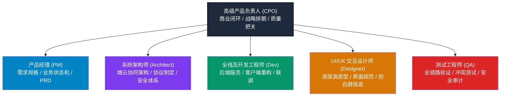
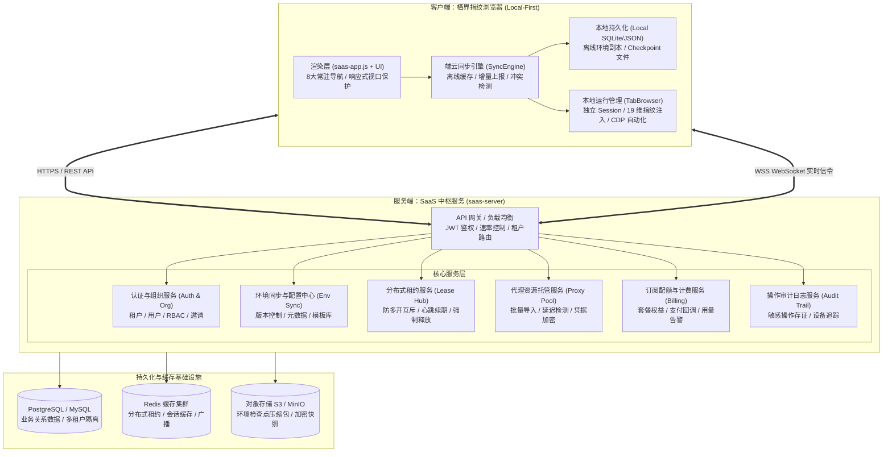

# 栖界指纹浏览器：SaaS 商业成品产研落地推进全景规划书

> **文档性质**：商业 SaaS 成品研发推进纲领与跨职能协同规范  
> **制定人**：高级产品负责人（CPO / 产研总监）  
> **基线版本**：Electron v37.2.6 / 客户端 0.1.0  
> **制定日期**：2026-10-24  

---

## 一、项目现状深度评估与差距分析

### 1.1 现状资产诊断（已具备的核心资产）
1. **指纹内核底层（已达行业先进水平）**：
   - 具备 Chromium 源码级 C++ 原生补丁集合，覆盖 Canvas、WebGL、Audio、ClientRects、时区、字体、Screen、WebRTC、DeviceMemory 等 19 个核心指纹维度（100% 覆盖率）。
   - 实现确定性种子化噪声算法，保证相同配置下跨会话指纹一致性；
   - 支持 TLS Client Hello / JA3 / JA4 预设与参数对齐，Pixelscan 与 Iphey 检测基线通过。
2. **单机客户端运行时（成熟可用）**：
   - 定制 Electron 主进程与多标签页管理器（`TabBrowser`），实现会话级隔离与独立 `sessionData`；
   - 集成自动化控制服务（`AutomationServer`）、媒体抓取器（`MediaHub`）与自媒体创作者中心（`CreatorHub`）。
3. **领域算法模型雏形（开箱可用）**：
   - 拥有完善的 `workspace-access.js`（RBAC 角色权限模型，4 类角色、7 种原子动作）；
   - 拥有 `workspace-lease.js`（基于 Fencing Token 的分布式环境租约互斥算法）；
   - 拥有 `environment-checkpoint.js`（基于目录深度遍历、SHA-256 哈希比对的环境快照算法）。

### 1.2 SaaS 关键差距与空白断点（0 到 1 缺失）
1. **服务端完全缺失**：
   - 仓库内无任何实际运行的 API 服务端（`saas-server` 为空白），无多租户数据库、无用户身份认证系统（JWT/OAuth）。
2. **单机存储孤岛**：
   - 客户端配置与环境数据完全保存在本地磁盘（`environments.json` 等），用户切换设备无法同步，无灾备恢复能力。
3. **界面展示脱节（Mock 占位假象）**：
   - 客户端界面中的“团队成员”、“代理资源池”、“操作审计记录”、“订阅与用量配额”、“工作空间切换”全为前端静态写死的 Mock 数据，未接入任何真实后端。
4. **协同并发安全未落地**：
   - 团队多成员协同缺少服务端租约互斥，同环境多人启动会导致 Cookie 覆盖或平台风控关联封号。
5. **商业闭环缺失**：
   - 缺少订阅套餐配置、支付渠道回调、坐席/环境配额核验与到期熔断机制。

---

## 二、产研团队组织架构与 RACI 职责矩阵

### RACI 职能分配表
- **R (Responsible)**：直接负责执行该项工作
- **A (Accountable)**：对该项工作的最终结果负全责（审批人）
- **C (Consulted)**：提供专业输入与咨询
- **I (Informed)**：知晓进展

| 工作模块 | CPO (高级产品) | PM (产品经理) | Architect (架构师) | Dev (开发工程师) | UI/UX (交互设计) | QA (测试工程师) |
|---|:---:|:---:|:---:|:---:|:---:|:---:|
| 商业模式与套餐配额定义 | **A** | R | C | I | C | I |
| PRD 与业务状态流转图设计 | A | **R** | C | C | C | I |
| 端云混合架构与同步协议设计 | A | C | **R** | C | I | C |
| 安全体系与数据端到端加密 (E2EE) | A | I | **R** | C | I | C |
| `saas-server` 后端服务开发 | I | C | A | **R** | I | C |
| `fingerprint-browser` 客户端接入改造 | I | C | A | **R** | C | C |
| SaaS 客户端界面重构与设计规范 | C | C | I | C | **R** | I |
| 端云全链路、租约防多开与压力测试 | A | C | C | C | I | **R** |
| 上线发布与验收门禁审核 | **A** | C | C | C | C | C |

---

## 三、系统总体架构设计（端云协同模式）

针对指纹浏览器“强依赖本地渲染硬件、本地网络驱动，同时强依赖云端多设备共享配置”的特性，采用 **Local-First（本地优先）+ Cloud Sync（云端中枢协同）** 架构。

### 3.1 总体架构拓扑图

### 3.2 关键架构契约与机制

1. **分布式环境租约协议（防顶号与关联风控）**：
   - 客户端打开环境前，必须通过 `POST /api/v1/environments/:id/lease` 获取租约；
   - 服务端校验租约互斥，若已被占用则返回 `409 Conflict` 及占用者信息（用户、设备、IP）；
   - 成功获取返回 `leaseId` 与单调自增的 `fencingToken`；
   - 运行期间客户端每 30 秒发送心跳保活；环境关闭或意外退出后，租约释放。
2. **增量版本同步与冲突检测（Optimistic Concurrency Control）**：
   - 每个环境具备 `metadataRevision`（元数据版本）和 `checkpointVersion`（数据快照版本）；
   - 更新环境时携带当前版本号，服务端校验 `revision == current_revision`。若落后则拒绝提交并触发三方合并或拉取最新；
   - 文件同步基于 `environment-checkpoint.js` 生成的哈希清单（SHA-256），仅上传差异文件，减少出海大容量环境上传带宽。
3. **敏感凭据分级安全加密**：
   - **代理密码**：服务端采用 AES-256-GCM 主密钥加密存储，仅在下发给已授权成员的客户端时经由安全信道解密；
   - **浏览器敏感 Cookie / 登录态**：支持可选的端到端加密（E2EE），密钥由用户本地主密码（Passphrase）推导，服务端零知识托管。

---

## 四、各专业线工作分解结构 (WBS) 与交付卡片

### 4.1 产品经理 (PM)
- [ ] **PRD-01: 多租户组织与 RBAC 权限体系规格**：定义所有者 (Owner)、管理员 (Admin)、操作者 (Operator)、只读观察者 (Viewer) 的操作边界。
- [ ] **PRD-02: 环境生命周期与协同状态机**：明确 `未同步`、`云端就绪`、`运行中(当前设备)`、`锁定中(被协作成员占用)`、`同步冲突` 等状态的流转与用户感知。
- [ ] **PRD-03: 代理资源中心 PRD**：静态 IP/动态代理的批量导入模板、自动检测连通性、团队归属分配与隐蔽授权规则。
- [ ] **PRD-04: 商业计费与配额体系**：定义“个人版”、“团队版”、“企业版”的环境上限、成员席位、云同步空间、并发运行数。

### 4.2 系统架构师 (Architect)
- [ ] **ARCH-01: API-First 接口契约规范**：编写标准 OpenAPI 3.0 规范，制定统一的错误响应结构、分页规范、幂等性 Token。
- [ ] **ARCH-02: 数据模型与多租户隔离方案**：设计 PostgreSQL Schema，所有业务表严格包含 `tenant_id` / `workspace_id`，设立 RLS 策略或逻辑隔离。
- [ ] **ARCH-03: 端云同步协议与断点续传设计**：实现基于哈希比对的环境快照打包、压缩、断点上传/下载流程。
- [ ] **ARCH-04: 离线容灾降级策略**：断网状态下保证本地已下载环境可降级启动，恢复联网后主动对账。

### 4.3 开发工程师 (Dev - 后端与客户端)
- [ ] **DEV-01: `saas-server` 基础工程框架搭建**：初始化 Node.js / Fastify 服务端工程，配置数据库连接池、Redis 缓存与日志。
- [ ] **DEV-02: 认证与多工作空间模块**：用户注册、登录、JWT 签发与刷新、团队创建与邀请码入队。
- [ ] **DEV-03: 环境同步与租约服务**：移植复用 `workspace-lease.js` 逻辑至 Redis 分布式锁，完成环境增删改查 REST 接口。
- [ ] **DEV-04: 代理池与操作审计模块**：代理导入导出、健康度探测队列、操作审计事件异步入库。
- [ ] **DEV-05: 客户端 `fingerprint-browser` 端云混合重构**：接入网络适配层，将本地单机 Repository 升级为“本地缓存 + 远程同步”双引擎；移除前端静态 Mock 数据。

### 4.4 UI/UX 交互设计师 (Designer)
- [ ] **UI-01: 严格遵循 `AGENTS.md` 铁律**：保证 8 大主导航、左侧边栏在 100%~200% DPI 桌面缩放下常驻显示，严禁隐藏。
- [ ] **UI-02: 登录/注册/团队切换界面**：符合现代化出海 SaaS 风格的高质感视效，提供工作空间快捷切换浮窗。
- [ ] **UI-03: 环境列表协同状态指示器**：直观展示环境是否由其他成员占用（头像标记）、同步状态（同步中/已最新/有冲突）。
- [ ] **UI-04: 代理与审计交互优化**：批量导入模态框、健康度检测实时进度条、审计日志筛选与下钻明细抽屉。

### 4.5 测试工程师 (QA)
- [ ] **QA-01: 接口功能与端到端回归自动化**：针对 `saas-server` 所有 REST API 编写自动化测试（覆盖率 > 85%）。
- [ ] **QA-02: 多端并发租约防顶号专项测试**：模拟两台设备毫秒级并发抢占同一指纹环境，验证互斥锁与 Fencing Token 有效性。
- [ ] **QA-03: 端云同步中断与网络恶劣环境模拟**：在弱网、丢包、突然中断场景下测试快照同步一致性，确保无数据损坏。
- [ ] **QA-04: 安全与越权渗透测试**：测试操作者/观察者越权调用管理员接口、尝试越权导出他人环境 Cookie 等非法行为。

---

## 五、研发推进排期与里程碑计划 (Milestones)

| 阶段 | 周期 | 核心目标与交付物 | 责任人 | 门禁验收条件 (DoD) |
|---|:---:|---|:---:|---|
| **Phase 1: 基础设施与认证中心** | 第 1-2 周 | 1. 搭建 `saas-server` 骨架并打通数据库 2. 实现租户、用户注册登录与 JWT 认证 3. 客户端实现登录窗口与 Token 存储 | 架构师 / 后端 / 客户端 | 用户可在客户端登录，成功获取工作空间信息与个人权限。 |
| **Phase 2: 核心环境云同步与租约** | 第 3-4 周 | 1. 服务端环境 CRUD 与元数据同步 2. 基于 Redis 的分布式租约防多开服务 3. 客户端环境列表接入真实服务端 | 后端 / 客户端 / 架构师 | 多设备登录同一账号，环境数据毫秒级同步；A 设备打开环境，B 设备显示占用锁定。 |
| **Phase 3: 团队协同、代理池与审计** | 第 5-6 周 | 1. 团队成员管理、角色邀请与环境授权 2. 代理资源统一托管、分配与连通性检测 3. 全链路敏感操作审计记录入库与查询 | 后端 / 客户端 / UI设计 | 管理员可建号分配环境给操作者；操作者无法窃取代理密码或导出 Cookie；操作留痕。 |
| **Phase 4: 订阅计费、配额熔断与支付** | 第 7-8 周 | 1. 套餐权益中心与环境/席位配额拦截器 2. 支付渠道对接（Stripe/支付宝）与 Webhook 3. 账单明细与配额用满告警 | 产品经理 / 后端 / 客户端 | 超出环境配额时禁止新建；购买升级后即时生效配额；订单状态无漏单。 |
| **Phase 5: 全链路联调、压测与交付发布** | 第 9-10 周 | 1. 端云全链路自动化压测与故障注入 2. 安全渗透、越权检测与数据备份演练 3. 客户端正式打包与灰度上线发布 | 测试工程师 / 全体团队 | 性能压测达标（API P99 < 150ms），无 P0/P1 缺陷，发布稳定安装包。 |

---

## 六、高级产品负责人总结与即刻启动行动

作为高级产品负责人，我们必须明确：**商业指纹浏览器的核心壁垒在内核，但商业变现和客户续费的生命线在 SaaS 协同与数据安全。**
当前项目内核底座扎实，必须以最快速度补齐服务端与端云协同短板。

今日启动项：
1. **正式在工程中创立 `saas-server` 服务端工程体系**，确立与 `fingerprint-browser` 客户端的规范协同；
2. **落地核心数据契约与轻量级可运行 MVP 服务**，完成第一批接口骨架（鉴权、工作空间、环境、租约、代理、审计），让产研各角色立刻具备并行开发的坚实基石！
