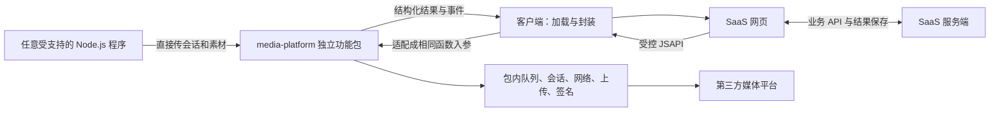

# 六平台图文动态发布：功能边界与接口协议

版本：设计稿 1.1；日期：2026-11-05；状态：待实施。按 Node.js 独立功能包边界修订；替代上一稿中的客户端执行宿主设计，协议尚未发布，不构成已实现接口。

## 1. 范围与设计结论

本期实现抖音、视频号、快手、小红书、新浪微博、微信公众号六个平台的 `dynamic` 发布及辅助参数查询。公众号 dynamic 为图集，与文章分开；`article/video` 保留判别联合扩展位置，本期未实现时明确返回不支持。

**media-platform 是独立 Node.js 功能包。只要具备受支持的 Node.js 运行时、平台所需的有效凭据和网络，即应完成平台接口调用，不需要客户端、Electron、SaaS、数据库或 RPA 宿主。** 本期基线为 Node.js 22 及以上受支持版本；跨 Windows、Linux、macOS 验证，不把“有任意历史版本 Node”视为兼容承诺。

1. 功能包自行完成网络请求、Cookie 管理、平台签名、素材读取/下载/上传、参数转换、发布、辅助数据查询、验证续发、状态查询、限流与并发；不是依赖宿主补齐执行逻辑的脚本集合。
2. 客户端负责校验和加载功能包，提供账号凭据接入、网页桥接、调用权限和结果转发；不得实现平台请求、签名、上传流程或第二套平台发布队列。
3. SaaS 管理内容、素材、用户、团队、业务任务和结果。SaaS 网页经客户端使用功能包能力；SaaS 服务端不执行平台脚本。
4. 功能包入口不出现 workspaceId、environmentId、SaaS accountId、clientId、leaseId、grant、executionHandle、tabId、desktopBridge。平台真实用户 ID、平台 Cookie 和代理属于正常平台调用上下文，不属于业务项目耦合。
5. 发布入口固定 `submitPublish(input)`；发布辅助查询入口固定 `queryPublishOptions(input)`。工厂及所有方法使用单对象参数，新增字段不改变函数签名。
6. 平台代码在各自目录。通用队列、HTTP、素材、会话和错误处理在包内公共模块；RPA/浏览器登录可以有独立适配层，但不是 Node 发布接口的运行前提。

本期交付目标为立即正式发布；草稿、平台原生定时、文章与视频暂不开放。参考实现中的草稿步骤可以是正式发布的中间过程，不能据此将“草稿创建成功”当作“正式发布成功”。本期不开展参考项目所有评论、私信、统计等能力的实现，但公共包结构必须允许继续扩展这些第三方平台接口，不能设计成 SaaS 专用发布插件。

## 2. 参考项目的完整调用链与依赖分析

以下路径相对于 `F:/awork/coozf.nodeservice`。实际入口为 `src/cloud/task/taskService.ts`。分析覆盖导出、入队、Worker 转换、平台实现、上传/签名、辅助查询和回传；未执行任何真实账号发布。

### 2.1 统一入口实际做了什么

```text
src/index.ts → src/cloud/index.ts 的 Cloud 导出
  → pushOpenPlatformPublishTask / pushLocalPublishTask
  → enqueueOpenPlatformPublishTask
  → PubConfig.pushingSchedulerService.push(PushingScheduledTask)
  → PlatformWorker 构造：按 authorInfo.platform 创建平台 Worker
  → PlatformWorker.publish：转 BaseSinglePublishTaskDynamic
  → 平台 Worker.publish：将通用字段映射为平台 TaskInput
  → 平台 publishDynamic：读取图片、获取身份/上传凭证、上传、签名、提交
  → postBackPublishProcess / postBackPublishResult：事件或业务 HTTP 回调
```

| 源码位置 | 已核实的行为 | 提取边界 |
| --- | --- | --- |
| `src/index.ts`、`src/cloud/index.ts` | 同时导出各平台原始 API、Cloud 入口、QueryWorker、PubConfig、AccountService | 目标包保留统一能力入口和平台模块，不把 Cloud 命名或业务服务作为运行前提 |
| `taskService.ts:158–195` | 云端入口要求回调 authorization，本机入口使用 feedbackHandler；两者共用入队 | 核心只接受平台任务与事件订阅；HTTP/Socket 回传由调用方封装 |
| `taskService.ts:216–307` | 从 taskSet.platform 按账号补 Cookie、真实账号 ID 和平台编码；部分平台补 localStorage；按平台+作者设置 runMutexId | 调用方提供平台凭据；包内负责规范化并隔离会话，不读取业务账号表 |
| `taskService.ts:446–586`、`:596–914` | 创建平台 Worker，转换内容类型，调用 worker.publish，再回传结果和发起审核轮询 | 保留统一路由和类型转换；发布与审核分离，轮询不阻塞发布执行槽 |
| `src/Config.ts:141`、`src/cloud/schedule-service/` | 发布配置为 5 个 processor；队列按 runMutexId 跳过运行中的账号 | 并发配置和调度属于功能包实例；不依赖 PubConfig 全局变量和客户端锁接口 |
| `taskService.ts:1559–1747`、`:2027–2399` | QueryWorker 凭平台、Cookie/localStorage 创建同类 Worker，统一话题/音乐等查询；音乐字段被转换为 id/title/artist/url | 新辅助入口与发布共用平台注册和会话层，返回统一数据结构 |
| `taskService.ts:1052–1428`、`:3429–3506` | 支持本机事件，也会依赖 API_URL、API_Token、OpenCallBackUrlPath、业务素材 key 转下载 URL | 不迁入核心；调用方传可读取的素材源、订阅结果，自行保存或通知业务系统 |

表内未带完整路径的 taskService.ts 均为 `src/cloud/task/taskService.ts`。行号只作本次源码定位，后续以函数名为准。

### 2.2 六个平台的真实执行步骤

| 平台键 / 既有业务编码 | 参考入口与底层文件（均在 src 下） | 已追踪的发布链路与差异 |
| --- | --- | --- |
| `douyin` / `DouYin` | `cloud/task/platform/douyinworker.ts:321` → `media-platform/douyin/douyin-dynamic.ts:48` | 获取 sdkToken、用户/上传授权；上传图片和封面；buildDynamicPostData_v2 构造参数；publishDynamicResponse 提交 create_v2。ticket-guard 从安全存储生成；风控时保留 checkStr/postData 供验证续发 |
| `shipinhao` / `ShiPinHao` | `shipinhaoworker.ts:213` → `shipinhao/shipinhao-article.ts:36`、`shipinhao-article.service.ts:34` | 取得 uin/finderUsername 与 authKey，逐图上传，构造媒体和标签信息，提交 post_create。参考 publishId 来自首图地址 encfilekey，不能直接当作品 ID |
| `kuaishou` / `KuaiShou` | `kuaishouworker.ts:165` → `kuaishou/kuaishou-article.ts:50`、`kuaishou-article.service.ts` | 获取图集上传参数，上传并完成图片、封面，saveUploadedImages，再 buildPostData/publish；结果用 currentTime 或作品列表的 uploadTime 作为 publishId，不是真实作品 ID 的通用契约 |
| `xiaohongshu` / `XiaoHongShu` | `xiaohongshuworker.ts:186` → `xiaohongshu/xiaohongshu-article.ts:50`、`xiaohongshu-base.service.ts` | 先校验投票/组件，申请 upload permit，上传图片，buildPostData，签名后提交 note。作品已生成 ID 后，组件校验仍可能报错，必须保留已创建证据，禁止直接重发 |
| `weibo` / `XinLangWeiBo` | `xinlangweoboworker.ts:182` → `xinlangweibo/xinlangweibo-micro-article-service.ts:132` | 刷新首页 Cookie、获取账号上下文、上传图片、转换话题/提及、提交 statuses/update；正式 ID 与 schedule_id 分支不同。参考代码会截断图片，不照搬静默截断行为 |
| `wechat` / `WeiXinGongZhongHao` | `weixingongzhonghaoworker.ts:222` → `weixingongzhonghao/weixingongzhonghao-dynamic.ts:48` | Worker 获取 token/ticketId/ticket/uin；图集代码检查扫码保护，读取/上传图片及裁剪图、构建并创建/更新图集草稿，按 notifySubscribers 选择公开或群发准备，最终 pushMsgResponse。组合 appMsgId_userId 需标明引用类型 |

第一列 Worker 路径均位于 `src/cloud/task/platform`；底层简写目录均位于 `src/media-platform`。视频号、快手和小红书的文件名虽含 article，其函数实际用于 dynamic，迁移按行为判断，不能按文件名重新分类。

### 2.3 辅助数据并不只有话题和音乐

| 参考统一方法 | 目标 resource / 操作 | 平台差异 |
| --- | --- | --- |
| `searchTopic`、`searchParticipationTopic` | `topics/search`、`participation-topics/search` | 普通话题与活动参与话题不同，不混用 ID；抖音、视频号、快手、小红书、微博有普通话题实现 |
| `searchMusic`、`getMusicByCategory` | `music/search`、`music/list`，filters 表达分类 | 抖音、视频号、快手有实现；视频号 cursor 包含页码和 buffer，必须由包封装；小红书方法明确返回不支持；微博、公众号沿用基类不支持 |
| `getCollectionList`、`searchLocation`、`searchUserList`、`getActivityList` | `collections`、`locations`、`users`、`activities` | 同名方法还受 contentType 和账号权益约束；公众号参考合集入口仅接受 article，不能据此宣称 dynamic 已支持 |
| `getWechatRewardAuthors/Replies/CharityProjects`、`resolveContentLink` | `wechat.reward-authors`、`wechat.reward-replies`、`wechat.charity-projects`、`wechat.content-links` | 专用参数的获取、身份/token 准备和结构转换均在包内 |
| `createVote`、`saveRoute`、`uploadAttachment`、`createLiveNotice` | 独立的 `executePlatformAction` 操作 | 是有副作用的辅助动作，不伪装成只读查询；按实际需求分期开放 |

`BaseWorker` 的默认实现多数返回 code=444；QueryWorker 部分 catch 返回 undefined。目标接口必须明确区分“不支持”“失败”“成功但为空”，不得沿用静默失败和默认成功的账号权益占位值。

### 2.4 不能原样继承的依赖

| 证据 | 当前依赖/风险 | 目标处理 |
| --- | --- | --- |
| `src/http.ts:252`、`:371`、`:404` | HTTP 读取 PubConfig；默认 TLS 校验关闭；公共网络错误重试可能覆盖提交请求 | 独立实例 HTTP 配置，默认校验证书；只读/上传/正式提交分别定义重试策略，禁止跨账号修改全局默认值 |
| `src/utils.ts:311–389` | 图片支持 URL、本地文件和 yi-file 协议，实际使用 Node HTTP/fs，不需要客户端上传宿主 | 包内提供 file/url/bytes 三种素材源；移除业务协议依赖；数据来源安全由包配置和客户端边界分别校验 |
| `xiaohongshu-base.service.ts:7–9`、`:380`、`xiaohongshu-article.ts:593` | 正式提交调用固定域名 qianming.yixiaoer.cn 的 getNewSign；同目录虽有本地 xiaohongshu-sign.js，但当前提交未使用它，不能认定替换后有效 | 签名实现及所需资产必须随包交付并在纯 Node 验证；可选远程签名模式由包直接处理且须显式配置，不得默认依赖参考项目的服务 |
| `douyin/douyin-video.service.ts:1992`、`douyin-publish-risk.ts`、`douyin-base.ts`、`utils.ts:getSignServerUrl` | ticket-guard 有本地 crypto 逻辑；其他签名辅助仍存在远程签名地址。不同调用不能笼统视为“签名已本地化” | 按实际调用逐一追踪，默认路径需本地闭环；所需 storage 列入凭据 schema，缺失返回 SESSION_INCOMPLETE |
| `src/Config.ts`、`src/http.ts`、`src/utils.ts` | 全局 API 地址、静态并发实例、用户目录、日志和 HTTP 相互依赖；导入配置可能启动队列 processor | 使用实例生命周期，import 无网络、定时器、目录写入或自动清理；工厂创建实例，dispose 显式释放 |
| 各平台发布代码与 taskService.ts 回调 | 日志可能拼接 Cookie/请求正文；各函数可能截断图片、补默认尺寸、发送后禁用取消、泛化自动重试 | 保留平台流程，改为显式校验、真实素材信息、脱敏日志和提交检查点；不继承伪造 ID 或“网络异常请重新发布”的危险默认 |

**独立性缺口：当前参考源码不能直接证明六平台已经满足“无外部签名服务的完整 Node 包”。设计要求由 media-platform 补齐这些能力，不能把缺口转嫁给客户端或 SaaS。** 本次未实现或验证签名替换，不将上述分析写成已完成能力。

## 3. 项目职责与调用流程

### 3.1 包、客户端和 SaaS 的边界

| 所属层 | 负责 | 不包含 |
| --- | --- | --- |
| media-platform | 平台目录、会话规范化与真实身份检查、HTTP/代理/Cookie、签名、下载/读取/上传、发布参数转换、辅助查询/动作、队列与账号互斥、验证续发、发布结果/审核查询 | 业务数据库、团队权限、SaaS 路由、云端回调地址、客户端环境目录、Electron IPC、desktopBridge、必需的宿主执行接口 |
| 客户端 | 受信包的检查/下载/校验/Node 加载；创建一个包实例；调用权限；把业务账号引用转换为会话输入、素材引用转换为包支持的来源；桥接消息和结果过滤 | 平台 URL/签名/上传协议、按平台 switch 的发布算法、平台参数二次转换、替代包的 HTTP 或并发调度 |
| SaaS 服务端 | NestJS 业务接口、用户/团队/账号/素材权限、内容与业务任务持久化、业务执行者分配、结果审计、能力文件发布管理 | 平台脚本执行、平台签名服务、媒体上传服务 |
| SaaS 网页 | 编辑、能力驱动的字段显示、业务任务创建、通过客户端调用、业务结果同步 | 包下载/执行、Cookie 获取、构造平台请求、任意本地路径/脚本执行 |
| 其他 Node 调用方 | 直接导入功能包，提供真实平台凭据、素材、可选代理并读取结果 | 不必安装或启动上述任何项目 |

客户端读取当前会话并传入包，是调用上下文适配；包读取该数据并完成平台接口调用，是平台能力。客户端调用已有账号授权/恢复链取得凭据不等于核心依赖该链：其他 Node 调用方可以直接提供同结构凭据。登录扫码 UI 与“使用有效会话调用平台接口”是两件事，不把浏览器登录环境写成所有发布/查询的必要条件。

### 3.2 两种调用方式必须使用同一套核心



客户端不得要求包回调 `host.request/host.uploadAsset/host.acquireExecutionLease` 才能工作。通用日志或存储扩展可以是可选项，但必须有可工作的包内默认实现；不能以“可注入适配器”之名把完整平台执行责任交给调用方。

授权期间不写 SaaS 中间任务的既有规则仍适用于授权；发布业务任务可以持久化，两者不混用。

## 4. 稳定协议与类型

### 4.1 版本和字段规则

- 核心公开 API 为 `media-platform-api/1`，发布 DTO 为 `media-publish/1`，辅助查询为 `media-publish-options/1`；客户端桥接另用 `client-media/1`。核心版本不取决于客户端版本。
- 所有公开函数固定一个 input 对象；新增可选字段、查询资源和平台专有 schema 不改变参数个数。变更必填字段、字段含义或默认行为才升级协议主版本。`requires` 指明调用所需能力，旧包执行前明确拒绝。
- wire DTO 只传 JSON；核心 Node API 额外允许 Uint8Array 素材和工厂配置中的可选回调，这些不直接穿过桥接。时间为 UTC 毫秒整数，平台游标为不透明字符串。
- 展示性 metadata 可忽略未知字段；可见范围、正文、图片、音乐等执行字段及 platformOptions 须验证 schema，不能静默丢弃。分页、账号和内容类型错误均显式返回。
- 平台键只使用六个小写值；历史业务编码仅在接入边界映射。以下是待实现契约，不是已有接口。

### 4.2 核心包的独立入参

```ts
type PlatformKey = 'douyin' | 'shipinhao' | 'kuaishou' | 'xiaohongshu' | 'weibo' | 'wechat';
type ContentType = 'dynamic' | 'article' | 'video';
type JsonValue = string | number | boolean | null | JsonValue[] | { [key: string]: JsonValue };
type JsonObject = { [key: string]: JsonValue };

interface PlatformCookie {
  name: string;
  value: string;
  domain: string;
  path?: string;
  secure?: boolean;
  httpOnly?: boolean;
  hostOnly?: boolean;
  sameSite?: 'strict' | 'lax' | 'none';
  expiresAt?: number;
}
interface PlatformSession {
  cookies: PlatformCookie[];
  storage?: Record<string, Record<string, string>>;
}
interface PlatformContext {
  session: PlatformSession;
  expectedUserId?: string;
  isolationKey?: string;
  network?: {
    proxy?: { url: string; username?: string; password?: string };
    userAgent?: string;
    timeoutMs?: number;
  };
}
type MediaSource =
  | { kind: 'file'; path: string }
  | { kind: 'url'; url: string; headers?: Record<string, string> }
  | { kind: 'bytes'; data: Uint8Array };
interface ImageInput {
  mediaId: string;
  source: MediaSource;
  sha256?: string;
  mimeType?: string;
  byteLength?: number;
  width?: number;
  height?: number;
}
interface OptionRef {
  platformKey: PlatformKey;
  resource: string;
  id: string;
  label: string;
  schemaVersion: string;
  data?: JsonObject;
  expiresAt?: number;
  platformUserId?: string;
}
interface DynamicContent {
  title?: string;
  text: string;
  images: ImageInput[];
  coverMediaId?: string;
  topics?: OptionRef[];
  music?: OptionRef;
  location?: OptionRef;
}
interface PublishTaskV1 {
  protocol: 'media-publish/1';
  taskId: string;
  idempotencyKey?: string;
  platformKey: PlatformKey;
  contentType: 'dynamic';
  context: PlatformContext & { expectedUserId: string };
  content: DynamicContent;
  options?: {
    visibility?: 'public' | 'private' | 'friends';
    comments?: 'platform-default' | 'enabled' | 'disabled';
  };
  platformOptions?: { schemaVersion: string; values: JsonObject };
  requires?: string[];
  metadata?: JsonObject;
}
```

context 的 cookies/storage 就是平台所需凭据，不需要先向客户端换取句柄。storage 按完整来源保存，例如抖音安全存储、小红书 b1，不把存储伪装成 Cookie 字符串。包按平台 schema 验证和准备签名，临时 token/ticket/uploadAuth 由包获取，不要求调用方预先拼装。

发布必须提供 expectedUserId；包获取真实身份比对后才上传和提交，防止错账号。查询身份本身可以不提供该值。isolationKey 是可选的通用互斥键，不具有任何环境目录含义；不传不影响 Node 调用。包不读取 SaaS 的 accountId，也不根据业务 ID 冒充平台身份。

每个 task 固定一个平台、一个账号、一个内容快照；批量只是一组独立任务。taskId 由任意调用方生成，标识最长 128 字符。业务 batchId/attemptId 可由调用方另行映射，不作为核心必填字段。

本期图文至少一张图片；顺序即发布顺序，封面引用当前 mediaId。包必须读取真实大小/格式/尺寸验证，不沿用参考实现的默认 4096 尺寸、静默 slice 截图数或伪造话题 ID。正文为纯文本，结构化话题由包转换；富文本插入位置若后续需要，新增带 schema 的内容标注字段，不恢复 HTML 内嵌 raw 的旧协议。

省略 visibility 的产品默认是 public，SaaS 表单显示该默认；comments 默认 platform-default。不支持的可见性或评论要求直接拒绝，不擅自转换。平台专有字段、通知粉丝、原创声明等放 platformOptions，其 schema 和映射完全由包维护。

file/url/bytes 都由包自行读取、下载和上传。核心在调用方明确提供的文件/网络权限内运行；客户端禁止网页直接传 file/path/headers，而由自身将已授权素材转换为安全来源。媒体来源允许刷新，但 idempotency 内容摘要以真实素材摘要和正文参数为准，不因签名下载 URL 变化而认为内容改变。将来 article/video 使用独立 content 判别联合扩展，不改变函数签名。

### 4.3 统一返回、状态和事件

```ts
interface MediaError {
  code: string;
  message: string;
  retryable: boolean;
  details?: { field?: string; capability?: string };
}
type Reply<T> = { ok: true; data: T } | { ok: false; error: MediaError };
type ExecutionState = 'queued' | 'running' | 'waiting-user' | 'reconciling'
  | 'succeeded' | 'failed' | 'cancelled' | 'unknown';
interface PublishReceipt {
  submission: 'accepted' | 'rejected' | 'unknown' | 'not-submitted';
  contentId?: string;
  references?: Array<{ kind: 'content' | 'draft' | 'submission' | 'media' | 'correlation'; id: string; idType: string }>;
  completion?: 'complete' | 'partial';
  warnings?: Array<{ code: string; message: string; field?: string }>;
  url?: string;
  auditStatus: 'unknown' | 'pending' | 'approved' | 'rejected';
  platformCode?: string;
}
interface TaskSnapshot {
  taskId: string;
  jobId: string;
  state: ExecutionState;
  stage: 'validate' | 'prepare' | 'upload' | 'submit' | 'verify' | 'cleanup';
  progress?: number;
  message: string;
  receipt?: PublishReceipt;
  error?: MediaError;
  sequence: number;
  updatedAt: number;
  runtime: { packageVersion: string; apiVersion: 'media-platform-api/1' };
}
interface TaskEvent {
  eventId: string;
  jobId: string;
  sequence: number;
  occurredAt: number;
  snapshot: TaskSnapshot;
}
```

JSAPI 兼容既有 `{ok:false,error:"中文说明"}` 约定：成功返回 `{ok:true,data}`；失败将内部 `MediaError.message` 映射到 `error` 字符串，并增加同级 `code`、`retryable`、可选安全 `details`。不得将内部 `Reply` 的 error 对象直接暴露为旧桥接的 error 字段。SaaS HTTP 新接口与能力包内部使用上述 `Reply`。

`ok:true` 只表示此次调用成功，例如任务入队或状态读取成功；发布成功必须检查 task.state 和 receipt。`succeeded` 指平台确认正式发布受理，可能仍处审核中；审核拒绝只更新 auditStatus，不回写成“从未提交”。contentId 仅填真实作品 ID；视频号 encfilekey、快手时间线索、公众号组合值放带 idType 的 references，不能伪装为 contentId。包按平台真实响应认定受理，上传完成、页面跳转、HTTP 200 或任意非空 ID 均不足以证明受理。作品已受理但组件绑定失败，保留 accepted 与真实 ID，并返回 completion=partial/warnings，不能当作可重发失败。

### 4.4 统一发布与辅助查询函数

```ts
interface QueryPublishOptionsInput {
  protocol: 'media-publish-options/1';
  requestId: string;
  platformKey: PlatformKey;
  contentType: ContentType;
  context: PlatformContext;
  resource: string;
  action: 'search' | 'list' | 'resolve';
  query?: { keyword?: string; cursor?: string; limit?: number; filters?: JsonObject };
  requires?: string[];
}
interface OptionItem {
  ref: OptionRef;
  description?: string;
  previewUrl?: string;
  attributes?: JsonObject;
}
interface OptionsPage {
  items: OptionItem[];
  nextCursor?: string;
  hasMore: boolean;
}
interface PublishAdmission {
  accepted: Array<{ taskId: string; jobId: string; state: ExecutionState }>;
  rejected: Array<{ taskId: string; error: MediaError }>;
}
interface PlatformActionInput {
  requestId: string;
  platformKey: PlatformKey;
  context: PlatformContext;
  operation: string;
  params: JsonObject;
  idempotencyKey?: string;
}
interface MediaPlatformService {
  getCapabilities(input: { platformKey?: PlatformKey; contentType?: ContentType; context?: PlatformContext }):
    Promise<Reply<{ platforms: JsonObject[] }>>;
  submitPublish(input: { protocol: 'media-publish/1'; requestId: string; tasks: PublishTaskV1[] }):
    Promise<Reply<PublishAdmission>>;
  queryPublishOptions(input: QueryPublishOptionsInput): Promise<Reply<OptionsPage>>;
  executePlatformAction(input: PlatformActionInput): Promise<Reply<JsonObject>>;
  getPlatformIdentity(input: { platformKey: PlatformKey; context: PlatformContext }):
    Promise<Reply<{ platformUserId: string; name?: string; avatar?: string }>>;
  getPublishState(input: { jobIds: string[]; afterSequence?: Record<string, number> }):
    Promise<Reply<{ snapshots: TaskSnapshot[]; events: TaskEvent[] }>>;
  checkPublishStatus(input: {
    platformKey: PlatformKey; contentType: ContentType; context: PlatformContext;
    receipt: PublishReceipt;
  }): Promise<Reply<PublishReceipt>>;
  cancelPublish(input: { jobId: string; reason?: string }): Promise<Reply<TaskSnapshot>>;
  resumePublish(input: {
    jobId: string; action: 'continue' | 'reconcile';
    challengeId?: string; response?: JsonObject; context?: PlatformContext;
  }): Promise<Reply<TaskSnapshot>>;
  configureExecution(input: { config: Partial<MediaExecutionConfig>; expectedRevision: number }):
    Promise<Reply<{ revision: number }>>;
  dispose(input: { mode: 'drain' | 'cancel' }): Promise<Reply<{ disposed: boolean }>>;
}
interface MediaPlatformConfig {
  execution?: Partial<MediaExecutionConfig>;
  state?: { mode: 'memory' } | { mode: 'file'; directory: string; encryptionKey: Uint8Array };
  onEvent?: (event: TaskEvent) => void | Promise<void>;
  onSessionUpdate?: (update: { platformKey: PlatformKey; platformUserId: string; session: PlatformSession }) => void | Promise<void>;
}
declare function createMediaPlatform(input: MediaPlatformConfig): MediaPlatformService;
```

`createMediaPlatform({})` 必须能在纯 Node 中创建可用实例，所有默认实现都随包提供；无 host 参数、无客户端初始化步骤。状态默认内存；调用方选择 file 时使用包内文件状态库，提供目录和 32 字节加密密钥属于通用配置，不要求业务实现 Journal。回调都是可选观测出口，不是运行依赖；回调失败不改变平台已受理的事实，状态和事件可通过 getPublishState 补读。context/session 输入由包复制，不能修改调用方原对象；账号会话变更按 platformKey/platformUserId 返回。

辅助资源统一为 topics、participation-topics、music、music-categories、locations、collections、statements；专有资源使用 wechat.reward-authors 等命名空间。每项声明支持的 action/contentType、输入/结果 schema；不能据“基类有方法”就声明支持。query limit 默认 20，范围 1–50；平台 cursor 由包封装。空结果是成功的空 items，未实现返回 CAPABILITY_UNSUPPORTED，失败返回明确错误。

OptionRef 是可序列化的平台选项，不是客户端令牌。包返回必要、非敏感的 data，schemaVersion 明确其含义；发布时校验平台、资源、版本、有效期和适用账号，需要时重新 resolve。label 只展示。data 不能包含 Cookie/签名、任意 URL/HTTP 片段；新查询或选项字段通过注册表和 schema 扩展，不让客户端解析 raw。

创建投票、保存路线、上传附件、创建直播预告属于 executePlatformAction，须声明副作用、幂等及结果 schema；本期未启用的操作返回不支持。统一入口不表示任何 operation 都能执行。后续账号/作品查询等第三方能力继续在包内按领域增加稳定的单对象接口，不借助 SaaS 或客户端补齐。

## 5. 并发、幂等与任务生命周期

### 5.1 配置与调度全部属于功能包

```ts
interface MediaExecutionConfig {
  publishConcurrency: number;
  perPlatformConcurrency: Partial<Record<PlatformKey, number>>;
  queryConcurrency: number;
  maxQueuedPublishes: number;
  maxQueuedQueries: number;
  queueTimeoutMs: number;
  executionTimeoutMs: number;
  queryTimeoutMs: number;
  userInteractionTimeoutMs: number;
}
```

首期默认发布总并发 2、单平台 1、查询总并发 2；发布/查询排队上限分别 200/50；排队超时 30 分钟、执行 15 分钟、查询 30 秒、人工验证 5 分钟。这些是包默认值，不是平台限额，可在 createMediaPlatform({execution}) 配置，或通过 configureExecution 原子更新。

并发必须为 1–16 的整数，队列上限 1–10000，超时为不超过 24 小时的正整数；缺失的单平台配额取 1，显式值不能超过发布总并发。configureExecution 用 expectedRevision 防止配置覆盖，返回递增 revision；未提供配置字段保持当前值。

- 包实例拥有唯一调度器，所有公开发布入口均经过它；不暴露绕过调度的高层 publishDynamic。全局、平台、真实账号三个约束同时满足才上传/提交，同平台账号写操作并发固定 1；账号键使用 platformKey+expectedUserId，真实身份不匹配时直接拒绝，不产生平台写副作用。
- 可选 isolationKey 用于调用方希望串行的其他资源。队列跳过被锁任务，避免一个账号占住队头；队列任务不抢占执行槽。身份准备、素材读取、上传、正式提交均计入执行槽，请求级并发另受包内 HTTP 限制。
- 查询具有独立配额，但需遵守会话一致性；会修改 Cookie/签名状态的请求与同账号发布互斥，等待发布完成。UI 防抖属于网页交互，不替代包内查询限流。
- 合法批次最多 100 项，逐任务返回 accepted/rejected；结构不合法整体拒绝。队列满返回 QUEUE_FULL。降低并发不取消已运行任务，提高并发唤醒队列；任何账号锁/全局槽的取得和释放均由包内原子状态管理。
- 人工验证时包释放执行槽、保留账号/isolationKey 锁；继续后重新取槽。不要求客户端提供 acquireExecutionLease 或全局信号量。
- 超时由包内 AbortController 传递到所有 HTTP、下载、上传和验证轮询，确认底层结束后再释放锁。不能仅使用 Promise.race 超时就让下一任务接管账号。
- 并发保证范围是一个包实例。多个进程/机器的业务总量不是本地 SDK 能承诺的，调用方自行做业务任务分配；这不成为包运行前提。客户端所有窗口复用同一实例，默认不并行启用两个不同版本实例，切换方式见第 8 节。

### 5.2 核心幂等与业务幂等分开

1. 包按实例中的 taskId 和可选 idempotencyKey 去重；同键同输入返回原 jobId，同键不同内容返回 IDEMPOTENCY_CONFLICT。业务团队、attempt 和数据库唯一键不进入核心。
2. 包对规范化的正文、平台、真实账号、图片顺序/真实摘要、选项计算内容指纹；凭据、代理、回调和 URL 临时鉴权不属于发布内容。显式 idempotencyKey 要求素材提供 sha256，包自行读取后核对；无摘要时仍可发布，但只承诺同 taskId/同素材来源描述的重投递去重，不能把可变 URL/本地路径当作不可变内容证明。来源刷新必须提供相同的已核验摘要。
3. checkpoint=not-submitted/submitting/accepted/rejected/unknown 属于包内任务状态。正式请求发送前先写 submitting；收到平台受理证据后写 accepted 和类型明确的 references，再发事件。内存模式仅提供当前进程保障，file 模式才能跨重启恢复检查点；两种能力如实声明。
4. 崩溃、断网或超时遇到 submitting，先由包的平台 reconcile 查询，不直接重发；没有可靠依据则保持 unknown。不得拿相同标题/相近时间的另一作品当作本任务的确定成功证据。
5. 包的正式提交请求关闭通用自动重试，上传步骤只按其幂等凭证重试；只读请求允许限次退避。参考公众号无条件再 push、公共 axios 网络自动重试等须逐条审查，不能原样继承。
6. SaaS 独立对业务 idempotencyKey 建唯一约束并分配执行客户端，维护 businessTaskId/attemptId → SDK taskId/jobId；不改变核心函数。第三方平台不识别本系统的锁或数据库事务，不能承诺跨设备严格只执行一次。

### 5.3 验证、会话变化与恢复

- 包输出 waiting-user 和 challengeId、验证方式、必要的二维码或引导信息；验证请求、结果检测、原始 postData 的保管和续发仍在包内。纯 Node 调用方也可使用 resumePublish 提交验证响应或请求对账，不必提供 tabId。
- 客户端可展示验证信息、承载平台原生验证界面并刷新凭据，但不实现按平台拼验证码请求或续发 postData。敏感输入只传到包，不写入进度事件/日志；需要凭据更新时用 resumePublish.context，而非新建整条发布任务。
- 包收到 Set-Cookie 或签名会话变化后维护账号内的 Cookie jar，完整保留来源/path/属性，不能合并跨域 Cookie。onSessionUpdate 将变更后的完整会话交给受信调用方；客户端处理自己持久 Session 的同步，SaaS 正式会话保存仍按既有权限链。回调只在凭据接入层使用，不透传给网页事件。
- 提交前取消：停止请求并清理后 cancelled/not-submitted；提交后取消：只停止后续活动并进入对账，不能表示删除作品。需要用户核对时返回 unknown，不自动撤销或再次发布。
- Node 调用方生命周期由其自行管理。客户端页面刷新不删除包内任务；客户端封装决定调用者能否恢复读取，但不更改包的任务事实。使用 file 状态库时由包恢复检查点，客户端只重新补齐受权会话输入，不能读取/解释平台内部恢复数据。
- getPublishState 不因一次读取删除终态，事件按 jobId 单调递增 sequence。包保留终态至少 7 天（file 模式），过期清理不删除调用方素材；业务结果是否已入库由 SaaS 自己管理，不要求包等待 SaaS acknowledge 才能正常运行。

## 6. 客户端只是加载器与桥接封装

### 6.1 加载边界

当前 platform-runtime.js 使用仅含 window/URL/定时器的 VM，缺少正常 Node require，且 start 只允许 authorize/reauthorize/check。这是现有客户端加载器的限制，不是功能包的能力边界。

客户端应在有完整 Node 环境的独立工作线程/进程中加载已校验发布物，创建并复用 createMediaPlatform 实例。加载器只定义模块加载、生命周期、IPC 传输和来源权限，不定义平台执行宿主协议。不得为每个平台增加客户端代码。

旧授权 API 仍由既有授权适配链处理；新 Node 核心不导入浏览器授权适配代码。为了兼容旧授权需要双入口/旧版通道时，只在发布与加载层区分，不让核心反向依赖 desktop/rpa。

### 6.2 网页与客户端的协议（不是核心包的协议）

桥接协议为 client-media/1；运行时声明 media-publish-v1、media-publish-options-v1，并返回实际加载的核心 apiVersion/packageVersion。只给固定受信首页开放，普通标签和媒体平台页面不注入私有 API。移动端只有存在等价 Node 运行环境且完成实测才声明支持，不能以 WebView 等同于 Node。

```ts
interface ClientAccountRef {
  scope: string;
  resourceId: string;
}
interface ClientImageInput extends Omit<ImageInput, 'source'> {
  assetRef: { kind: 'remote'; url: string } | { kind: 'local'; handle: string };
}
type ClientPublishTask = Omit<PublishTaskV1, 'context' | 'content'> & {
  content: Omit<DynamicContent, 'images'> & { images: ClientImageInput[] };
};
interface SubmitMediaPublishInput {
  protocol: 'client-media/1';
  requestId: string;
  items: Array<{ dispatchId: string; accountRef: ClientAccountRef; task: ClientPublishTask }>;
}
```

| 固定单对象签名 | 网页输入 → 客户端转换 → 核心调用 |
| --- | --- |
| `mediaPublishCapabilities({platformKey?,contentType?,accountRef?})` | 普通能力直取 getCapabilities；账号能力先解析受权会话，再查询包 |
| `submitMediaPublish({protocol,requestId,items})` | items=[{dispatchId,accountRef,task}]；task 为去掉 context 且素材改用受权引用的业务命令；客户端补 context/MediaSource 后调用 submitPublish |
| `queryMediaPublishOptions({protocol,requestId,accountRef,platformKey,contentType,resource,action,query?,requires?})` | 补受权 context 后原样调用 queryPublishOptions，不转换平台原始参数 |
| `readMediaPublish({jobIds,afterSequence?})` | 检查 job 属于调用来源，再读 getPublishState |
| `cancelMediaPublish({jobId,reason?})` | 检查所有权，调用 cancelPublish |
| `resumeMediaPublish({jobId,action,challengeId?,response?})` | 检查所有权并补齐必要会话，调用 resumePublish |

accountRef={scope,resourceId} 指客户端现有、受业务授权的账号会话映射；它只在桥接层存在，不传入包。taskId 为此次 SDK 执行标识，SaaS 的 businessTaskId/attemptId/dispatchId 由适配层保存映射。未知 accountRef、跨来源/团队、普通网页或会话未就绪时明确拒绝；不得仅凭网页自报的真实账号 ID 取另一会话。

桥接任务的图片使用 `{mediaId,assetRef,sha256?,mimeType?,byteLength?,width?,height?}`。assetRef 为 `{kind:'remote',url}`（SaaS 返回的已授权素材 URL），或 `{kind:'local',handle}`（客户端文件选择器登记的引用）；禁止页面提供本地 path、任意 headers 和 Cookie。客户端校验来源/本地引用权限后转换为 url/file，下载和平台上传由包完成。过期 URL 经 SaaS 重新授权后换入同摘要来源，不由包访问 SaaS 获取素材 key。

成功桥接返回 `{ok:true,data}`；失败兼容旧约定 `{ok:false,error:'中文说明',code,retryable,details?}`，核心仍使用 Reply，不反向依赖旧桥接的错误字段格式。snapshot 的 session、代理密码、平台请求正文均不传网页；onSessionUpdate 仅到受信客户端封装。

configureExecution/dispose 由客户端配置与加载器控制，不开放普通网页直接操作。SaaS 业务参数只改变 task/content，不改核心实例的并发或下载源策略。

### 6.3 身份、素材与业务授权各自归属

SaaS 登录、CSRF、团队/账号权限及业务任务分配在服务端校验；客户端校验固定首页身份、账号会话映射和本地调用者权限；包验证平台真实身份与会话可用性。dispatchId 只用于业务执行分配和追踪，不作为密码、签名或核心权限令牌。

需要跨设备取得账号会话时，继续使用已有 prepareLaunch/desktop-launch-v1/会话恢复链；客户端完成该层后，将标准 PlatformSession 给包。不把 desktop-launch-v1、RSA 公钥、续约信封或业务许可写入核心类型，也不因辅助查询引入包必需的 SaaS 授权接口。网页不获得明文 Cookie。

核心的 HTTP/Cookie/代理是 Node 会话，与 Electron Session 是不同运行对象。客户端负责输入快照与会话变化同步；包负责本次请求链的 Set-Cookie、重定向和签名一致性。包自身不读取 Electron 用户数据目录，也不要求媒体平台页面已经打开。

## 7. SaaS 业务 HTTP 协议和存储

以下新增业务接口只属于 SaaS，全部由 NestJS 模块管理，校验登录、CSRF、工作空间、账号与素材归属。核心包不包含这些路径、登录态和数据库模型，客户端也不直连数据库。

| 方法与路径（前缀 /api/workspaces/:workspace） | 请求与结果 |
| --- | --- |
| `POST /publish-batches` | `{requestId,tasks:[{accountId,platformKey,content,options?,platformOptions?,idempotencyKey}]}`；保存业务内容快照，返回 batchId、逐项任务/错误 |
| `GET /publish-batches/:batchId` | 返回业务执行、受理、审核状态和当前 attempt，不含凭据 |
| `POST /publish-tasks/:taskId/execution` | `{clientId,expectedRevision}`；条件分配单一执行者，返回 dispatchId、此次 sdkTaskId、内容快照、accountRef、受权素材源；无 Cookie |
| `POST /publish-tasks/:taskId/events` | `{dispatchId,attemptId,events}`；校验归属并幂等保存包事件，返回已保存 sequence |
| `POST /publish-tasks/:taskId/cancel` | 记录 cancelRequested；网页通知客户端，包确认实际状态后保存，离线时显示待处理 |
| `POST /publish-tasks/:taskId/retry` | `{expectedRevision}`；仅明确无副作用失败可新建 attempt/sdkTaskId，unknown 或 accepted 不直接重发 |

业务任务与 SDK 任务分离：SaaS 的 taskId 为长期业务主键；每次 attempt 生成独立 sdkTaskId，传给核心 taskId。dispatchId 关联当前执行者，不加入核心输入。网页刷新可恢复事件同步，不创建新的 SDK 执行任务。

SaaS 通过平台目录和客户端返回的能力描述显示字段，不维护第二份平台 URL、签名逻辑、图片限制或参数映射。话题/音乐等实时查询走客户端及包，不通过 SaaS 代理平台 API；查询失败不伪造空列表。

建议 Prisma 模型为 PublishBatch、PublishTask、PublishAttempt、PublishEvent；正式账号仍引用 platform_accounts，不复制凭据到任务。业务幂等键、task/attempt/sequence 建唯一索引；执行者条件分配可在 PublishAttempt 中保存，跨设备账号排他规则由 SaaS 业务层维护。使用 Prisma 事务，不引入 SQL 旁路和 MySQL 外键。

离线或心跳丢失表示客户端状态未同步，不能改成平台发布失败，也不能自动分配给另一设备重发。需要后续租约调度时可在业务层增加，不改变 SDK。迟到 accepted 结果保存到原 attempt 并触发业务对账，不覆盖另一 attempt。

HTTP 使用 Reply；400 为结构错误，401/403/404 分别为未登录/无权限/不存在，409 为业务幂等或执行者冲突，422 为参数或能力不支持，429 为限流；500 只返回中文安全错误。合法批次部分失败逐项返回。客户端结果沿用受控客户端信任模型记录，不宣称 SaaS 已独立验证平台最终状态。

## 8. 平台目录、Node 发布物及兼容迁移

### 8.1 包内组织与稳定策略接口

```text
src/
  index.ts                         Node 核心公共导出
  contracts/                       DTO、错误码、版本、schema
  core/
    service.ts                     工厂、统一发布/辅助查询入口
    scheduler.ts                   包内并发与账号锁
    http.ts                        Node HTTP、代理、取消、请求级重试
    session.ts                     Cookie jar、来源规则、会话变更
    media.ts                       file/url/bytes 读取和真实信息检查
    state.ts                       内存/文件状态库、事件、检查点
    registry.ts                    显式平台注册
  platforms/
    douyin/                        index.ts、dynamic.ts、options.ts、signer.ts、schema.ts
    shipinhao/                     同上，按实际需要增加 upload.ts 等
    kuaishou/                      同上
    xiaohongshu/                    同上
    weibo/                         同上
    wechat/                        同上
  adapters/                        独立可选接入，不被 Node 核心导入
```

各平台统一实现 `getIdentity({context})`、`validate({task})`、`publishDynamic({task,runtime})`、`queryOptions({request,runtime})`、`checkStatus({request,runtime})`、`resume({request,runtime})`；只由包内部 service/registry 调用。runtime 包含 HTTP、素材、签名、Cookie jar、取消和进度等**包内实现**，由包创建，不是外部 host 参数。

平台独有的 endpoint、签名算法、上传凭证准备、分页解析和字段转换只在其目录内。后续添加 article.ts/video.ts 时保留外部统一入口。现有 auth 模块保留并按实际修改渐进接入，不以此次协议设计为由重写无关授权代码。

getCapabilities 返回核心 apiVersion/packageVersion、Node 要求，各平台 availability、contentTypes、字段约束、辅助资源/action、平台专有 schemaVersion/schema、真实验证状态。包支持的功能与当前账号权益分开；可选 context 提供账号级检查，没有 context 只返回静态能力。账号权益占位值或参考代码未实现的方法不能标为可用。能力描述必须来自包，客户端/SaaS 只消费，不分别维护平台能力表。

### 8.2 一个 Node 能力包，两种交付消费方式

- Node/npm 使用：正式 Node 入口导出 apiVersion、packageVersion、createMediaPlatform 和类型声明；不从旧 server.cjs 懒加载整个参考 SDK 来冒充新的独立核心。
- 动态交付：同一 Node 入口 NCC 为自包含 CommonJS 单文件，允许 Node 内置模块，不遗留第三方 require、外部原生模块、开发机路径或运行时下载的签名脚本。签名所需 JS/数据资源编译进包；图片处理也由可跨平台的包内实现完成。
- Node ESM 调用方可使用 CommonJS 默认导出，不能假定 NCC 自动支持具名 ESM 导入。类型声明随开发包提供；运行客户端只需单 JS 和清单。
- import/require 只定义导出，不发请求、不启动后台定时器、不创建业务目录。创建实例后才初始化其资源；dispose 释放网络连接、任务、计时器与状态库。
- RPA 继续独立更新；Node 发布核心不要求同时安装或加载 RPA。登录 UI 适配若使用 RPA，属于另一条消费链，不影响直接平台 API 使用。

新的动态产物使用明确的新清单 `format=media-platform-node-release/1`，至少包括 version、apiVersion、runtime.kind=node、runtime.minVersion、entry.file/sha256/bytes。入口名可为 `media-platform-{version}-{摘要}.cjs`，与旧 authorization 文件区分。模块声明与运行格式分开验证；摘要依赖受信 HTTPS 发布源，不冒充发布者签名。

### 8.3 现有发布链的一次性迁移

现有客户端只接受 bridgeVersion=2、authorization-*.js 和 RPA 两件套，后台也仅有 platform/rpa 上传及 4 MB 限制；**不能宣称新 Node 包可以原样替换旧文件并兼容旧宿主。**

迁移按以下顺序进行：

1. media-platform 先产出并通过纯 Node 验证的核心；既有授权产物仍按旧通道发布，Node 入口不导入其 desktop/rpa 编排。
2. 后台增加独立 Node 包上传通道 `POST /api/system/platform-releases/platform-node` 及 `GET /api/platform-releases/node-manifest.json`；校验格式、大小、摘要、版本但不执行上传代码。旧 manifest 和上传入口保持旧语义，旧客户端不会误取 Node 包。
3. 客户端增加通用 Node 模块加载与 client-media/1 封装，复用现有 HTTPS 检查、缓存、回滚和管理员发布原则；不能把该次适配演变为平台专有宿主。新包体积需实测，再确定有界上限并同步后台/下载器，不能直接声称符合原 4 MB。
4. SaaS 探测 client-media/1 及具体包能力后才开放发布。管理员上传 Node 单 JS 后由服务端自动编号，客户端每次启动自行更新；业务网页不参与能力下载，SaaS 部署包不携带平台执行脚本。
5. 核心 API 未变化的后续平台更新仅更新包；新增核心 API 主版本、最低 Node 版本或桥接字段有破坏性变化时才评估调用方升级。第三方 endpoint、签名和上传协议变化不应要求客户端跟着修改。

客户端所有网页复用一个核心实例。默认更新策略为：预先校验候选模块 → 停止接纳新执行 → 旧实例队列排空并 dispose(drain) → 切换并创建新实例。存在待人工验证/待对账且无法安全迁移的状态时暂缓切换，禁止让新旧实例各自使用完整配额并行运行。需要未来无等待热切换时，应先在功能包自身实现版本无关调度/状态兼容，而不是再发明客户端平台执行宿主。

上述变更只涉及应用层加载与封装，不涉及 Chromium/Electron 原生编译；迁移完成前旧授权仍按其原协议运行，不将设计目标描述成现状。

## 9. 错误码与验收顺序

核心错误码至少包括 PROTOCOL_UNSUPPORTED、PLATFORM_UNSUPPORTED、CONTENT_TYPE_UNSUPPORTED、CAPABILITY_UNSUPPORTED、PARAMETER_UNSUPPORTED、INVALID_ARGUMENT、ACCOUNT_MISMATCH、AUTH_EXPIRED、SESSION_INCOMPLETE、SIGNING_UNAVAILABLE、IDEMPOTENCY_CONFLICT、QUEUE_FULL、QUEUE_TIMEOUT、OPTION_EXPIRED、ASSET_INVALID、RATE_LIMITED、USER_ACTION_REQUIRED、PLATFORM_REJECTED、SUBMISSION_UNKNOWN、EXECUTION_TIMEOUT、CANCELLED。中文 message 不包含原始错误对象、堆栈、Cookie、签名或原始正文；retryable 不表示可以重新提交已有副作用的发布。

CLIENT_UPGRADE_REQUIRED、PERMISSION_DENIED、业务执行者冲突等由相应边界返回，不包装成包内需要客户端/工作空间才能解决的错误。包内会话与签名完整性问题也不能让客户端自行实现签名算法补洞。

实施顺序：**纯 Node 核心与 DTO/schema → 包内公共设施及六平台实现/签名闭环 → 独立验收 → 客户端加载封装 → SaaS 业务与 shadcn/ui 接入 → 端到端验收。** 不以“先把执行宿主做出来”为功能包实施前提。

| 验收项 | 必须满足 |
| --- | --- |
| Node 独立性 | 在无 Electron、无客户端、无 SaaS、无数据库、无 RPA 的 Node 进程中，直接导入单 JS，提供有效平台会话和素材即可运行；无必填 host/业务句柄；初始 import 无后台副作用 |
| 网络独立性 | 正常默认路径只访问平台/CDN 和调用方明确指定的素材源，不访问参考项目签名服务器或业务后端；不能注入假签名、伪造上传或仅通过类型检查便宣称能力完整 |
| 六平台闭环 | 分别真实验证身份、图片上传、参数组装、签名、正式提交和结果判定；公众号图集必须走到最终受理；没有真实作品 ID 时不伪造 contentId |
| 辅助数据 | 话题、音乐、位置、合集、分页、成功空结果、不支持、失效会话、账号专属和过期选项分别验证；写辅助动作不能走只读查询 |
| 会话/代理 | 同一账号所有身份、签名、上传授权、CDN 上传、提交及状态查询沿用所配置出口；Set-Cookie/storage 变化一致，跨域/跨账号不串；参考代码中代理未传递到的请求需补齐 |
| 并发 | 纯 Node 进程中配置总并发、单平台、查询和账号锁即有效；热更新不会产生第二套执行池；超时/取消无残留请求继续提交 |
| 结果/恢复 | 重复提交幂等；提交后丢响应、部分组件失败、旧检查点恢复均不盲目重发；查询得到的只是时间线索时保持不确定性 |
| 桥接边界 | 核心 DTO 不含业务 ID/客户端句柄；客户端无平台 endpoint、签名或上传实现；外部网页无私有 JSAPI；网页拿不到会话明文和本地任意路径 |
| 签名稳定 | 新增可选字段/查询资源不改变单对象方法；旧版明确拒绝所需新能力；apiVersion 与客户端版本独立；未知执行参数不静默忽略 |
| 交付与跨平台 | 单 JS 不依赖源码目录、开发机工具或外部非内置 require；Windows/Linux/macOS 的受支持 Node 分别验证；真实发布需账号持有人明确授权 |

单元/协议测试可以使用明确的隔离测试夹具，但不能替代六平台真实验收，生产结果不使用 Mock/假数据。移植仅针对任务涉及代码，保留原有注释，依赖按需要审查并锁定；不复制整个参考工程或新建跨项目源码依赖。

本次只修订设计与项目边界说明：未实现新 SDK、未修改数据库、未构建客户端/平台包、未执行真实账号发布。小红书等本地签名替换仍是实施与真实验证事项，不能在文档中提前标为已完成。
