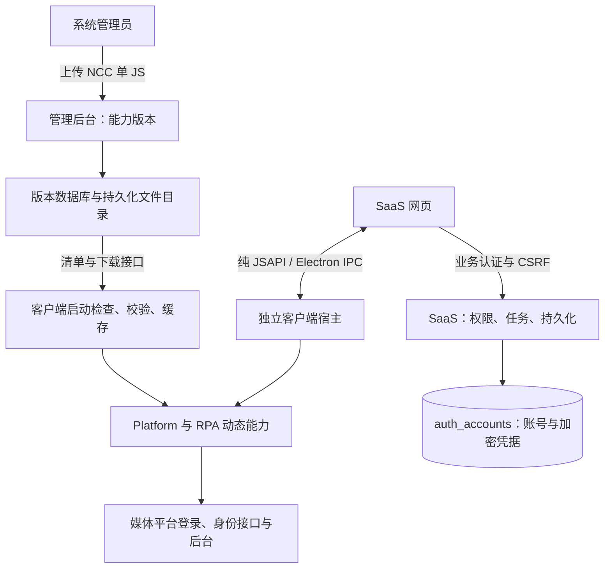

# 客户端授权与能力版本发布

## 当前链路

版本：客户端 0.3.1、SaaS 0.3.2；初始能力包 0.2.0；宿主协议 `platform-runtime-v2`。

Web 与客户端授权、打开、进度查询均经 JSAPI，不调用本机 HTTP 或 WebSocket。客户端仍需要访问媒体平台和能力发布源；网页仍通过自己的业务 API 保存账号。通用自动化 HTTP 接口属于其他既有功能，不用于本链。

## 授权与重新打开

1. SaaS 建立有团队、用户、环境、期限及可选原账号约束的授权任务；平台目录只维护业务支持范围。
2. 网页通过 `prepareLaunch` 获取一次性公钥，向环境启动接口提交 `authorizationId`。服务端将操作证明密钥放入加密启动信封；网页只转交密文。
3. 客户端解密并绑定任务、调用首页、标签、期限；从本机能力包取得平台入口和规则，不接受网页替换平台地址、来源或脚本。
4. 客户端加载 Platform 编排与 RPA 身份识别。只在真实平台响应包含稳定身份、会话字段就绪后采集；视频号等待 Cookie 落盘，抖音准备安全存储，小红书读取真实 user/info 身份并等待 b1。
5. 主进程用任务密钥对身份、会话、平台描述和版本做 HMAC，再用任务公钥加密。网页仅转交信封。服务端校验任务关联、HMAC、身份、来源、权限与原账号约束。
6. 待确认数据先暂存；确认事务同时写入 `auth_accounts`、业务账号摘要及成员资源范围。重复确认幂等；取消、到期、撤权和旧版本结果不得覆盖当前账号。
7. 打开已有账号时，服务端从 `auth_accounts` 读取凭据并封装为加密启动信封；客户端使用自身能力目录选择平台入口，复用匹配的本机会话，否则恢复云端快照。

操作证明用于保护正常桥接流程中的任务关联和网页转交结果，不能作为第三方设备的远程硬件认证。拥有本机主进程控制权的操作者属于客户端信任边界。独立能力文件也是受信代码，只允许系统管理员发布；摘要校验依赖 HTTPS 发布源与本机目录信任，不冒充发布者数字签名。

“检测授权”也由客户端执行。仅明确的 HTTP 401 或已实现的平台失效码才写入失效；网络异常、超时、无法识别身份不会冒充账号失效。重新授权仍限定原平台身份，普通授权只对失效或过期账号开放。

## 正式账号存储

`auth_accounts` 关键字段：

| 字段 | 用途 |
| --- | --- |
| `workspace_id,id` | 团队与业务账号联合主键 |
| `platform_code,platform_user_id` | 平台身份；同团队内联合唯一 |
| `platform_user_name,platform_avatar` | 真实账号资料 |
| `environment_id,authorization_operation_id` | 环境归属与本机会话复用关联 |
| `auth_type,auth_status` | 授权类型和当前有效性 |
| `platform_cookie_hash` | Cookie 数组加密密文；保留完整安全属性，并非不可逆摘要 |
| `platform_local_storage_hash` | 按来源分组的存储加密密文 |
| `session_version,origins,entry_url` | 恢复版本、来源与入口 |
| `last_authorized_at,last_checked_at,created_at,updated_at` | 授权、检测及审计时间 |

沿用服务器数据目录中的 `encryption.key`；不得替换密钥。启动时事务迁移已有业务账号的关系会话到 `auth_accounts`，保留账号 ID、会话版本和旧表数据；发现损坏、身份冲突或无法解密时回滚并阻止启动。已存在新凭据时不使用旧快照覆盖。

`records` 中的账号摘要继续承载界面与运营关系，不保存明文凭据。待确认任务仍使用既有临时关系会话，确认后清除临时数据。旧 `media_session_*` 表用于历史兼容和迁移恢复，不再承接新正式账号写入。回滚应用前必须先处理新版产生的凭据和账号，不能直接把旧服务启动视为无损回滚。

套餐沿用现有环境与成员权益规则；打开已有账号不新增环境或账号占用。本次没有引入未定义的计费项目，也没有将账号数量配额与积分余额混用。

## 管理后台发布

系统管理员进入 `/system-admin.html` → **能力版本**，分别选择 Platform 和 RPA 的 NCC 单文件 `.js` 并点击上传发布。

- 服务端仅接受有效 UTF-8 JavaScript、最大 4 MB；校验语法但不执行上传文件。上传者必须是系统管理员，并通过登录、CSRF 和来源校验。
- 每次上传原子递增发布编号；文件名包含编号和 SHA-256 摘要，旧文件保留。两个组件都存在时生成完整清单；更新单个组件时，另一组件继续引用最近发布文件。
- 数据库 `platform_releases` 保存组件、版本、摘要、文件大小、发布者及时间；`platform_release_state` 保存当前组合清单和全局递增版本。
- 文件默认保存在 `<SAAS_DATA_DIR>/platform-releases`，需要与数据库、`encryption.key` 一起持久化及备份。部署压缩包不携带管理员上传的资源或真实配置。

| 接口 | 权限与用途 |
| --- | --- |
| `GET /api/system/platform-releases` | 系统管理员：当前清单及最近发布记录 |
| `POST /api/system/platform-releases/platform` | 系统管理员：原始 `application/javascript` 请求体 |
| `POST /api/system/platform-releases/rpa` | 系统管理员：原始 `application/javascript` 请求体 |
| `GET /api/platform-releases/manifest.json` | 客户端：无会话依赖的组合版本清单 |
| `GET /api/platform-releases/{文件名}` | 客户端：不可变资源，服务端下载前重新校验摘要 |

清单形如 `{version,bridgeVersion:2,file,sha256,rpa:{version,file,sha256}}`。后台自动编号不要求编辑 JS 内嵌版本；客户端按清单标识版本，按字节摘要验证文件。

## 客户端本地缓存与启动更新

`client-config.json` 的 `platformManifestUrl` 指向上述清单。正式打包配置为 `https://qijie.xinmeitool.com/api/platform-releases/manifest.json`；开发地址为本机 8088。安装地址与发布地址可以不同。

每次客户端启动先验证本机 `platform-runtime/current.json` 指向的版本，再检查安装包中是否有更新种子，随后独立请求发布清单。更新成功前使用已校验缓存；新版本的两个文件全部下载、摘要及接口校验成功后才原子切换指针。失败不替换可用版本，不接受版本回退或同版本内容偷换。临时失败文件不被装载；旧版本保留用于诊断与恢复。

缓存位于当前客户端用户数据目录的 `platform-runtime`。安装程序目录只提供首次种子，后续更新不需要管理员写入 Program Files。运行中的任务持有原版本对象，新任务读取新版本；网页无更新地址、下载、安装或代码执行参数。

## 能力文件契约与构建

支持自包含 CommonJS 的 `module.exports`，或现有 IIFE 的 `window.MediaPlatform / window.MediaRpa`：

- Platform：`catalog`、`run({desktop,rpa,task,tabId,signal,onProgress})`。目录提供平台入口、HTTPS 来源、响应路径与存储字段白名单。
- RPA：`identity(platformKey,response)` 返回稳定平台身份或 `null`；可提供 `expired(platformKey,response,status)`。
- 宿主提供观察、导航、加密采集、受控身份刷新等接口。不开放任意文件路径、网页指定的代码或跨团队会话。
- 发布文件必须自包含、兼容宿主 VM；不能遗留外部 require、原生依赖或旁置资源。服务端语法通过不等于客户端接口兼容，客户端最终校验失败会保留旧包。

独立 `media-platform` 项目使用 `PLATFORM_NCC_CLI` 指定已有 NCC 工具后运行 `npm run release`，生成两个带摘要的单 JS 和组合清单。将两个 JS 分别上传后台即可；本机发布版本不替代后台发布编号。能力发布与 SaaS 应用打包互相独立。

## 交付及验证边界

### 界面与删除规则

SaaS 的 UI 开发统一遵守 [saas-server/AGENTS.md](../saas-server/AGENTS.md)。删除确认使用真实 React/Radix 的 shadcn/ui Alert Dialog，通过 `WorkspaceDialogs` 适配现有页面；`npm --prefix saas-server run build:ui` 生成自包含网页组件，部署打包前自动构建。界面依赖只用于构建，不进入 Node 服务端运行依赖。

授权选择平台后仅展示环境列表；选择环境即关闭全部业务弹框，后台等待授权结果，页面顶部成功绿色、失败红色。新授权按任务使用独立本机目录，同任务重试继续复用，避免带入模板环境中已登录的其他账号。

指纹、环境、代理、账号均支持删除。指纹或代理被环境引用、环境被账号引用时先解除关联；账号删除同时归档 `auth_accounts` 并取消关联的待完成授权任务，保留密文和历史记录。相同身份再次授权时在权限校验后恢复原账号 ID，不创建重复身份。

根目录 `npm run watch` 启动客户端应用层监听并转发控制台；`npm --prefix saas-server run watch` 启动 SaaS 监听。使用已核验的 Electron 运行时，不编译内核。

只改应用层，不修改 Chromium/Electron 原生源码、头文件、GN 配置或缓存。客户端包复用既有自定义 Electron 运行时；SaaS 单文件包不包含平台 SDK 或执行脚本，只含业务接口、发布资源管理及必要运行资源。

隔离数据库、协议、下载缓存和真实 Electron 界面测试不能代替四个平台由账号持有人扫码的真实登录验收；线上域名接口的部署可用性也需实际部署后确认。
