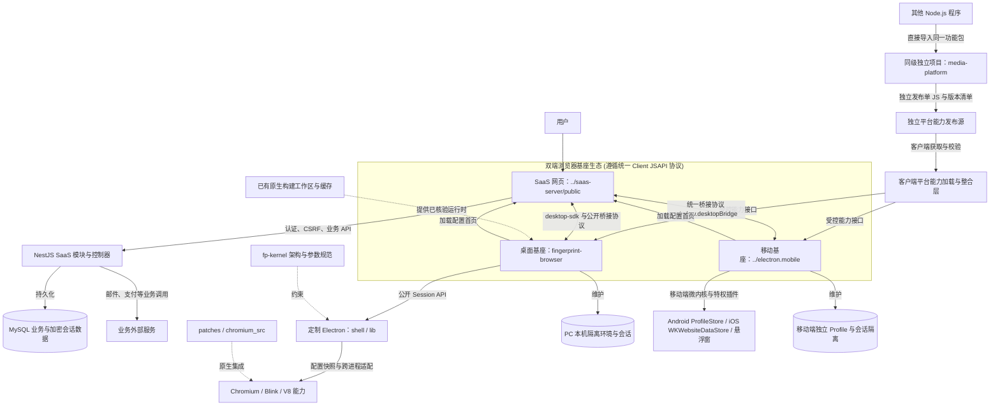
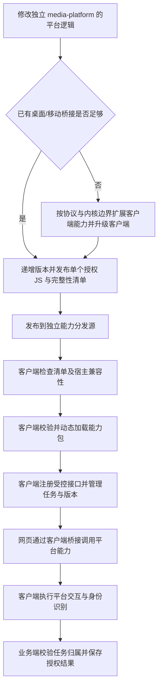
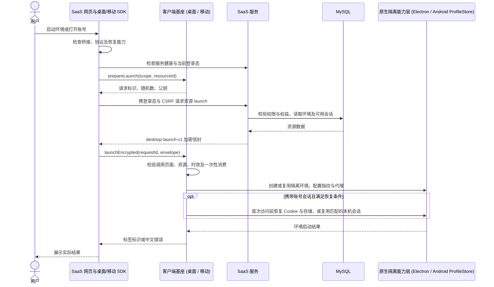
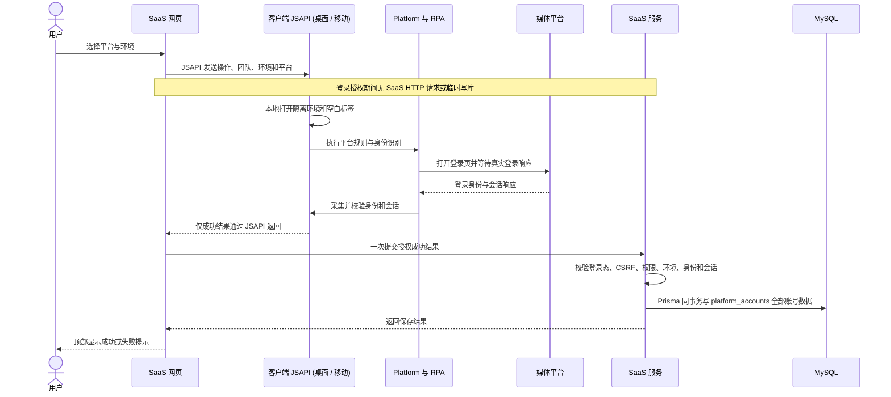
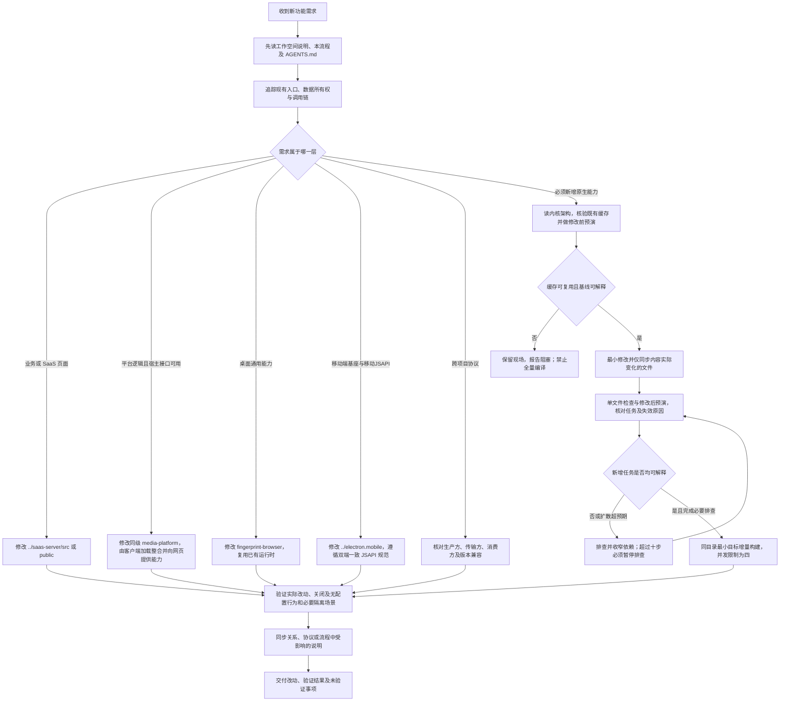

# 项目关系与开发流程

先阅读[工作空间说明](../工作空间说明.md)了解各目录职责。以下 Mermaid 图可在支持 Mermaid 的 Markdown 查看器中渲染；箭头文字区分调用、消息传递与构建产物，不表示跨项目源码导入。

## 项目关系图（平台能力与双端基座目标架构）

本图规定平台能力与双端基座的目标依赖：网页调用客户端整合后的能力，不加载 platform 执行脚本；能力更新源由 SaaS 管理后台的独立发布接口提供，不依赖 SaaS 业务网页。SaaS 页面统一面向客户端 JSAPI 契约（`window.desktopBridge`）开发，PC 桌面基座与移动基座（`../electron.mobile`）分别在各自宿主中提供等价的原生能力映射，实现“一套 SaaS 前端代码，无缝运行于桌面与移动两端”。同时，客户端 JSAPI 暴露具有严格的宿主安全边界：特权桥接对象仅注入于受信任的 SaaS 业务页面与本地宿主 Shell；所有在指纹环境或独立标签中打开的第三方外部媒体平台页面（如抖音、小红书、快手、X 等）保持绝对静默，严禁挂载私有 JSAPI 或防检测特征变量，确保第三方页面的全局 `window` 与标准纯净 Chrome 100% 一致。

## 平台能力独立发布与动态加载流程（目标）

目标是平台能力独立于客户端安装包更新，由客户端提供稳定的网页调用接口；任务执行期间的版本保持及切换由客户端管理。SaaS 不负责平台脚本加载、平台执行或能力发布编排，网页不能要求客户端加载任意地址的代码。

发布与辅助查询以独立 Node.js 功能包为边界：media-platform 自行实现 HTTP、Cookie/代理、签名、素材读写/上传、平台路由、并发与任务状态，其他 Node 程序可直接调用。客户端只负责加载、凭据/素材输入封装、权限与桥接转换，不为包提供必需的 request/upload/调度宿主。当前授权 VM 与该目标不同，迁移及稳定函数签名见[六平台发布设计](多平台发布功能边界与接口协议.md)；旧授权流程仍按下节现状执行。

### 当前实现说明

网页仅调用客户端 JSAPI；Platform 与 RPA 由客户端分别校验、动态加载并在用户数据目录缓存。管理员上传 NCC 单 JS 后，后台原子递增版本并发布清单；客户端启动时自行更新，在途任务保持原版本。SaaS 不再打包平台身份核验 SDK，正式凭据通过 Prisma 保存到 platform_accounts。旧平台发布物需升级宿主契约，详见[客户端授权重构](客户端授权重构.md)。移动端基座对齐计划详见 [SaaS 移动端基座与双端 JSAPI 对齐实施计划](../electron.mobile/docs/SAAS_MOBILE_BASE_AND_JSAPI_ALIGNMENT_PLAN.md)。

## 环境与账号启动流程

任一步校验失败应结束该次请求并反馈真实错误；普通网页模式缺少桥接时不执行本机启动。会话恢复的版本、来源、运行中标签限制以[公开协议](../fingerprint-browser/PROTOCOL.md)为准。

## 账号授权与会话保存流程（平台集成目标）

取消、失败、超时或身份不完整时，流程在客户端结束，不调用 SaaS 保存接口，也不写授权中间数据。检测授权同样由客户端完成，只有客户端返回明确有效/失效结果后才调用账号检测接口更新状态。网页的环境列表属于工作空间正常预加载数据；新授权使用客户端已存在的本机环境配置创建隔离 Session。

平台能力包 0.2.3 提供新浪微博和微信公众号账号查询；客户端 0.4.2 在指定授权响应命中后读取当前隔离 Session Cookie，并调用 Node 能力包核验真实身份，不依赖页面 DOM。打开账号的密文携带原账号身份，更新时核对平台、身份与来源，成功后同步资料并递增会话版本；保存失败可通过手动保存重试。

## 开发新功能流程

跨项目协议需求仍需分别选择所属应用文件实施；协议变更不自动意味着需要原生编译。验证使用所属项目现有测试，涉及联调时分别启动真实服务与客户端；涉及交付包时另行核对压缩包清单及实际启动。本地检查、外部服务验收与生产验证须分别记录。

六平台图文动态发布的职责、统一入口、可配置并发及 SaaS—客户端—media-platform 协议见[多平台发布功能边界与接口协议](多平台发布功能边界与接口协议.md)。该文档为待实施设计，不表示现有授权宿主已经支持发布；发布业务任务与既有授权期间不写中间任务的规则分别适用。
