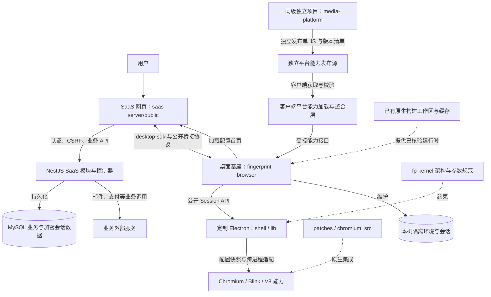
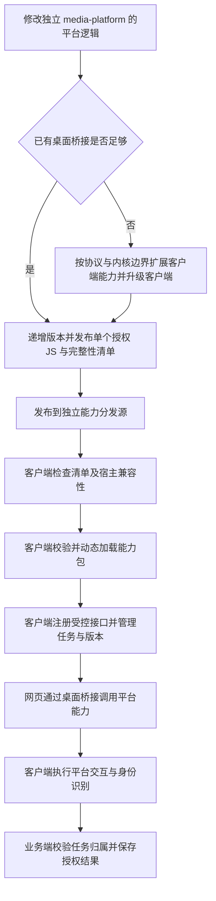
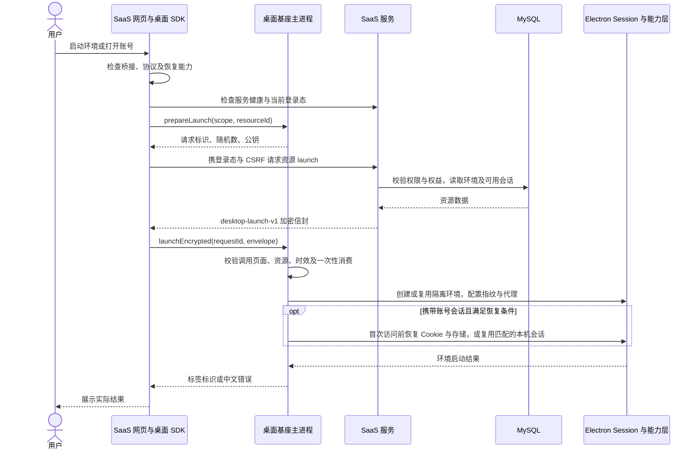
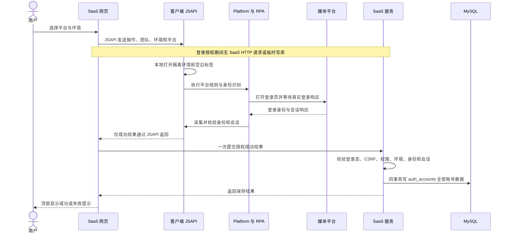
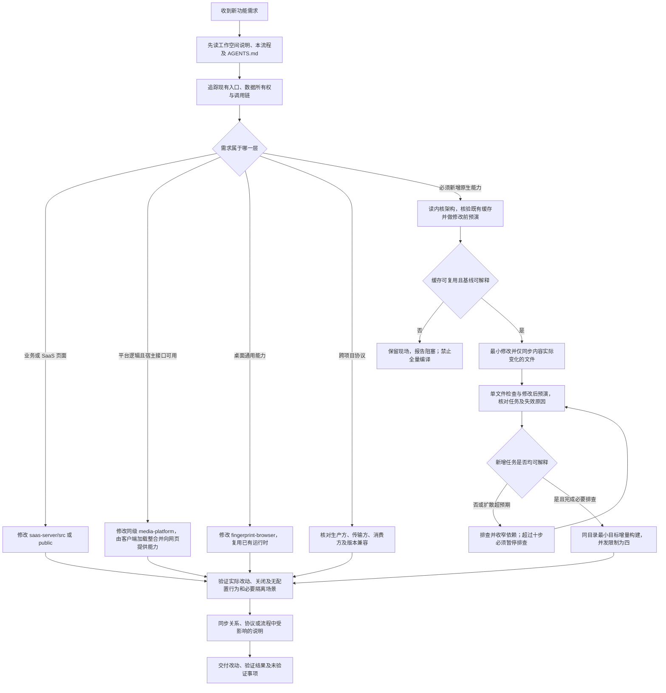

# 项目关系与开发流程

先阅读[工作空间说明](../工作空间说明.md)了解各目录职责。以下 Mermaid 图可在支持 Mermaid 的 Markdown 查看器中渲染；箭头文字区分调用、消息传递与构建产物，不表示跨项目源码导入。

## 项目关系图（平台能力目标架构）

本图规定平台能力的目标依赖：网页调用客户端整合后的能力，不加载 platform 执行脚本；能力更新源由 SaaS 管理后台的独立发布接口提供，不依赖 SaaS 业务网页。SaaS 可以独立部署，桌面可接入其他符合公开协议的业务首页。客户端加载整合、后台版本发布及本机缓存已按 platform-runtime-v3 接入，具体实现与验收边界见[客户端授权重构](客户端授权重构.md)。

## 平台能力独立发布与动态加载流程（目标）

目标是平台能力独立于客户端安装包更新，由客户端提供稳定的网页调用接口；任务执行期间的版本保持及切换由客户端管理。SaaS 不负责平台脚本加载、平台执行或能力发布编排，网页不能要求客户端加载任意地址的代码。

### 当前实现说明

网页仅调用客户端 JSAPI；Platform 与 RPA 由客户端分别校验、动态加载并在用户数据目录缓存。管理员上传 NCC 单 JS 后，后台原子递增版本并发布清单；客户端启动时自行更新，在途任务保持原版本。SaaS 不再打包平台身份核验 SDK，正式凭据保存到 auth_accounts。旧平台发布物需升级宿主契约，详见[客户端授权重构](客户端授权重构.md)。

## 环境与账号启动流程

任一步校验失败应结束该次请求并反馈真实错误；普通网页模式缺少桥接时不执行本机启动。会话恢复的版本、来源、运行中标签限制以[公开协议](../fingerprint-browser/PROTOCOL.md)为准。

## 账号授权与会话保存流程（平台集成目标）

取消、失败、超时或身份不完整时，流程在客户端结束，不调用 SaaS 保存接口，也不写授权中间数据。检测授权同样由客户端完成，只有客户端返回明确有效/失效结果后才调用账号检测接口更新状态。网页的环境列表属于工作空间正常预加载数据；新授权使用客户端已存在的本机环境配置创建隔离 Session。

## 开发新功能流程

跨项目协议需求仍需分别选择所属应用文件实施；协议变更不自动意味着需要原生编译。验证使用所属项目现有测试，涉及联调时分别启动真实服务与客户端；涉及交付包时另行核对压缩包清单及实际启动。本地检查、外部服务验收与生产验证须分别记录。
