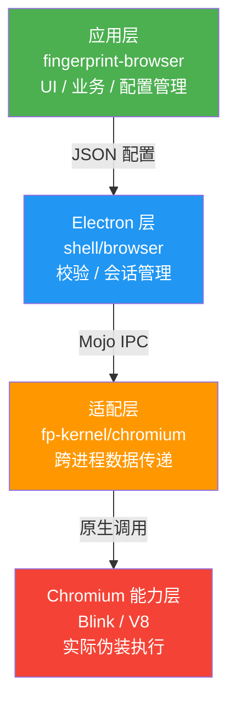
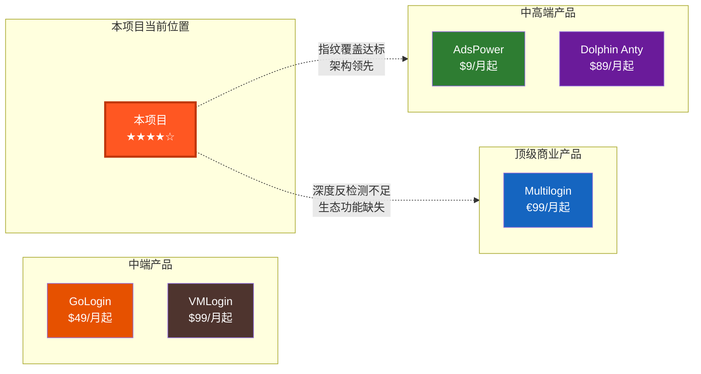
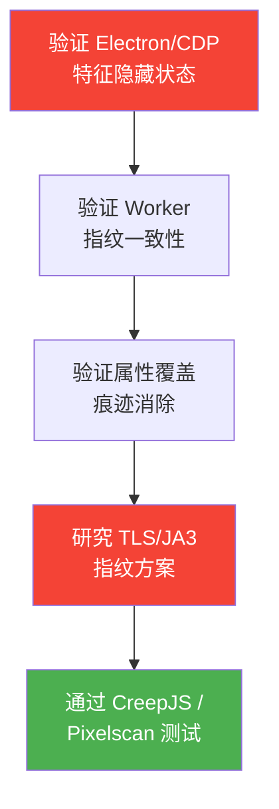

# 🔍 指纹浏览器商业水平评估报告

> [!NOTE]
> 本报告基于对项目源码架构、Chromium 原生补丁、应用层功能的全面审查，并与 Multilogin、GoLogin、AdsPower、Dolphin Anty、VMLogin 等主流商业产品进行对标分析。

---

## 一、总体评级

```
                        ┌─────────────────────────────┐
                        │     综合商业成熟度评级        │
                        │                             │
                        │       ★★★★☆  4.0 / 5.0     │
                        │                             │
                        │   已达商业发布水平（中上游）    │
                        └─────────────────────────────┘
```

| 评估维度 | 得分 | 商业标杆 |
|----------|------|----------|
| 指纹维度覆盖 | ★★★★★ 5/5 | 与 Multilogin 持平 |
| 原生实现深度 | ★★★★☆ 4/5 | 接近 Multilogin |
| 产品功能完整度 | ★★★★☆ 4/5 | 接近 AdsPower |
| 反检测对抗能力 | ★★★☆☆ 3/5 | 低于顶级产品 |
| 架构设计 | ★★★★★ 5/5 | 优于多数竞品 |

---

## 二、指纹维度覆盖对标

### 核心指纹维度（必备项）

| 指纹维度 | 本项目 | Multilogin | GoLogin | AdsPower | 评价 |
|----------|--------|------------|---------|----------|------|
| Canvas 噪声（种子化） | ✅ | ✅ | ✅ | ✅ | **达标** — 种子化确定性噪声，实现标准 |
| WebGL Vendor/Renderer | ✅ | ✅ | ✅ | ✅ | **达标** — 含参数/扩展/精度覆盖 |
| WebGL 渲染噪声 | ✅ | ✅ | ✅ | ✅ | **达标** — readPixels 噪声注入 |
| Audio 噪声（种子化） | ✅ | ✅ | ✅ | ✅ | **达标** — 覆盖 AudioBuffer + AnalyserNode |
| Navigator 全属性覆盖 | ✅ | ✅ | ✅ | ✅ | **达标** — UA/Platform/Language/硬件信息 |
| Client Hints (Sec-CH-UA) | ✅ | ✅ | ✅ | ✅ | **达标** — HTTP 头 + JS API 双覆盖 |
| Screen/Display | ✅ | ✅ | ✅ | ✅ | **达标** — 含 CSS 媒体查询一致性 |
| WebRTC IP 防护 | ✅ | ✅ | ✅ | ✅ | **达标** — 3 种策略 + ICE/SDP 替换 |
| Font 枚举控制 | ✅ | ✅ | ✅ | ✅ | **达标** — 白名单过滤机制 |
| ClientRects 噪声 | ✅ | ✅ | ✅ | ✅ | **达标** — 种子化微噪声 |
| 时区覆盖 | ✅ | ✅ | ✅ | ✅ | **达标** — V8/ICU 层面覆盖 |
| 地理位置覆盖 | ✅ | ✅ | ✅ | ✅ | **达标** |
| 媒体设备伪装 | ✅ | ✅ | ✅ | ✅ | **达标** |
| Battery API | ✅ | ✅ | ✅ | ✅ | **达标** |
| Speech Voices | ✅ | ✅ | ⚠️ | ⚠️ | **领先** — 多数竞品未覆盖 |
| DNT / GPC | ✅ | ✅ | ✅ | ✅ | **达标** |
| Hardware Concurrency | ✅ | ✅ | ✅ | ✅ | **达标** |
| Device Memory | ✅ | ✅ | ✅ | ✅ | **达标** |
| Max Touch Points | ✅ | ✅ | ✅ | ✅ | **达标** |

> **核心指纹覆盖率：19/19 = 100%** — 完全达到甚至略超主流商业产品水平。

---

### 深度反检测维度（中高端差异化项）

| 维度 | 本项目 | Multilogin | AdsPower | 重要性 | 评价 |
|------|--------|------------|----------|--------|------|
| TLS/JA3/JA4 指纹匹配 | ❌ | ✅ | ⚠️ | 🔴 关键 | **主要缺口** |
| Headless/自动化特征隐藏 | ⚠️ 未确认 | ✅ | ✅ | 🔴 关键 | **需核实** |
| 属性覆盖痕迹消除 | ⚠️ 未确认 | ✅ | ✅ | 🟠 重要 | **需核实** |
| Web Worker 指纹一致性 | ⚠️ 未确认 | ✅ | ⚠️ | 🟠 重要 | **需核实** |
| Service Worker 指纹一致性 | ⚠️ 未确认 | ✅ | ❌ | 🟡 中等 | **需核实** |
| 跨 iframe 指纹一致性 | ⚠️ 未确认 | ✅ | ⚠️ | 🟠 重要 | **需核实** |
| Port Scan 防护 | ❌ | ⚠️ | ✅ | 🟡 中等 | **待实现** |
| Keyboard Layout 指纹 | ❌ | ✅ | ✅ | 🟡 中等 | **待实现** |
| Emoji 渲染指纹 | ❌ | ⚠️ | ❌ | 🟡 中等 | **前沿** |
| WebGPU 指纹 | ❌ | ❌ | ❌ | 🟢 新兴 | **前沿** |

---

## 三、架构优势分析

本项目在架构设计上有几个显著优势，优于多数商业竞品：

### 1. 清晰的四层分层架构



> [!TIP]
> 这种分层解耦设计使得：Chromium 版本升级时只需维护补丁兼容性，不需要重写应用层；应用层功能迭代不影响原生指纹能力。多数商业竞品的代码耦合度更高，升级成本更大。

### 2. 种子化确定性噪声系统

- 相同配置在不同会话间产生一致的指纹值
- 噪声强度可配置，在"不可检测"和"足够区分"间平衡
- 位置感知噪声（Canvas/ClientRects 考虑像素位置）
- 渲染视觉无感知

### 3. 会话级完整隔离

- 每个浏览器环境独立的 `BrowserContext`
- 独立的 Cookie、LocalStorage、IndexedDB、Cache
- 通过 Mojo IPC 传递只读配置快照，无可变状态共享

### 4. 配置完整性校验

- `FingerprintProfileParser` 验证跨维度一致性（如 macOS 平台 + Windows 字体检测）
- 模板库中各维度参数经过预验证

---

## 四、产品功能对标

| 产品功能 | 本项目 | Multilogin | AdsPower | GoLogin |
|----------|--------|------------|----------|---------|
| 多开管理 | ✅ | ✅ | ✅ | ✅ |
| 环境隔离 | ✅ | ✅ | ✅ | ✅ |
| 指纹配置编辑器 | ✅ | ✅ | ✅ | ✅ |
| 一键随机指纹 | ✅ | ✅ | ✅ | ✅ |
| 指纹模板库 | ✅ | ✅ | ✅ | ✅ |
| 代理管理（多协议） | ✅ | ✅ | ✅ | ✅ |
| Cookie 管理 | ✅ | ✅ | ✅ | ✅ |
| 分组/标签 | ✅ | ✅ | ✅ | ✅ |
| 批量操作 | ✅ | ✅ | ✅ | ✅ |
| 自动化 API（CDP） | ✅ | ✅ | ✅ | ✅ |
| 团队协作/权限 | ✅ | ✅ | ✅ | ✅ |
| 导入/导出 | ✅ | ✅ | ✅ | ✅ |
| SaaS 云端同步 | ✅ | ✅ | ✅ | ✅ |
| 内置 RPA | ❌ | ❌ | ✅ | ❌ |
| 窗口同步器 | ❌ | ❌ | ✅ | ❌ |
| 插件/扩展市场 | ❌ | ✅ | ✅ | ❌ |
| 指纹质量评分 | ❌ | ✅ | ⚠️ | ✅ |
| Firefox 内核支持 | ❌ | ✅ | ✅ | ❌ |
| 移动端（Android） | ❌ | ⚠️ | ✅ | ✅ |
| 云端运行 | ❌ | ✅ | ❌ | ✅ |
| AI 创作中心 | ✅ | ❌ | ❌ | ❌ |

---

## 五、关键差距与风险分析

### 🔴 高优先级缺口（影响检测通过率）

#### 1. TLS/JA3/JA4 指纹 — 最大短板

> [!CAUTION]
> **TLS 指纹是当前项目最大的单点缺口。** 现代反欺诈系统（如 Cloudflare、Akamai、PerimeterX）会检查 TLS 握手特征是否与 User-Agent 声称的浏览器版本匹配。由于 Electron 内嵌的 Chromium 版本可能与配置的 UA 版本不同，TLS 指纹（JA3/JA4 哈希值）会暴露真实内核版本，直接导致检测失败。

**影响**：在严格的反欺诈场景（电商平台、广告平台、金融网站）中，TLS 指纹不匹配会直接触发风控。

**建议方案**：
- 短期：保持 Chromium 内核版本与配置 UA 版本尽可能一致
- 中期：研究 BoringSSL 层面的 TLS Client Hello 参数调整
- 长期：实现 TLS 指纹伪装（修改 cipher suite 顺序、扩展列表等）

#### 2. Electron/CDP 特征隐藏 — 需紧急核实

现代检测平台会检查：
- `navigator.webdriver` 属性
- `window.chrome` 对象完整性
- `document.$cdc_asdjflasutopfhvcZLmcfl_` 等 CDP 注入标识
- Electron 特有的全局对象（`process`、`require`）
- `navigator.plugins` 和 `navigator.mimeTypes` 的一致性
- `window.outerHeight - window.innerHeight` 等窗口尺寸差异

#### 3. 属性覆盖痕迹 — CreepJS 关键检测点

CreepJS 等工具会检测：
- 被覆盖的 getter 是否能通过 `toString()` 检测（应返回 `function get [name]() { [native code] }`）
- 原型链是否被修改
- `Object.getOwnPropertyDescriptor()` 返回值是否自然
- 属性的 `configurable`/`enumerable`/`writable` 特征是否正常

**由于本项目在 Chromium 原生 C++ 层面实现伪装而非 JavaScript 注入，理论上不存在此类痕迹。** 这是原生实现相比 JS 注入方案的核心优势，但需要验证确认。

### 🟠 中优先级缺口

#### 4. Web Worker / Service Worker 指纹一致性

检测平台会在 Worker 线程中重复指纹采集，对比主线程结果：
- `navigator.hardwareConcurrency`
- `navigator.userAgent`
- Canvas（OffscreenCanvas in Worker）
- Audio 等

**需验证原生补丁是否覆盖了 Worker 上下文。**

#### 5. 跨域 iframe 指纹一致性

严格检测平台会通过跨域 iframe 采集指纹并与主页面对比，检测是否存在不一致。

#### 6. 指纹质量评分/检测系统

商业产品（如 Multilogin、GoLogin）内置了指纹质量检测，用户创建配置后可以看到"质量评分"和潜在风险提示。这是重要的用户体验特性。

### 🟡 低优先级缺口

| 缺口 | 说明 | 紧急程度 |
|------|------|----------|
| Firefox 内核支持 | Multilogin/AdsPower 提供双内核 | 低 — 差异化而非必需 |
| 内置 RPA/无代码自动化 | AdsPower 特色功能 | 低 — API 已足够 |
| 窗口同步器 | 多窗口同步操作 | 低 — 高级功能 |
| 插件/扩展市场 | 社区生态 | 中 — 长期差异化 |
| 移动端 | Android 移动版本 | 低 |
| 云端运行 | 无需本地客户端 | 低 |
| Keyboard Layout | 键盘布局指纹 | 中 |
| Port Scan 防护 | 端口扫描防护 | 中 |

---

## 六、竞争力定位



**当前定位**：处于 **中高端商业产品水平**（AdsPower / Dolphin Anty 同级），距离顶级（Multilogin）主要差距在深度反检测能力和产品生态。

---

## 七、优先改进路线图

### Phase 1：达到顶级检测通过率（1-2 个月）



| 任务 | 预计工作量 | 影响 |
|------|-----------|------|
| 核实并完善 Electron/CDP 特征隐藏 | 1-2 周 | 🔴 高 |
| 验证 Worker/iframe 指纹一致性 | 1 周 | 🟠 中 |
| 验证属性覆盖痕迹（理论上原生实现无此问题） | 3 天 | 🟠 中 |
| TLS/JA3 指纹研究与实现 | 3-4 周 | 🔴 高 |
| 在主流检测平台（CreepJS/Pixelscan/iphey）全面测试 | 1 周 | 🔴 高 |

### Phase 2：产品差异化（2-3 个月）

| 任务 | 影响 |
|------|------|
| 内置指纹质量评分系统 | 提升用户体验 |
| Keyboard Layout 指纹 | 补全检测维度 |
| Port Scan 防护 | 补全检测维度 |
| 插件/扩展市场基础 | 建立生态 |

### Phase 3：生态建设（长期）

| 任务 | 影响 |
|------|------|
| Firefox 内核支持 | 差异化竞争 |
| 无代码 RPA | 降低用户门槛 |
| 窗口同步器 | 多开效率工具 |
| 云端运行 | 扩展使用场景 |

---

## 八、结论

> [!IMPORTANT]
> ### 核心结论
> 
> 1. **指纹维度覆盖已达商业标准**：19 个核心维度 100% 覆盖，部分维度（Speech Voices）还领先于多数竞品。
> 
> 2. **架构设计优于竞品**：四层解耦 + 原生 C++ 实现 + 种子化噪声 + 会话隔离的架构设计是重要竞争优势，远超 JS 注入类方案。
> 
> 3. **产品功能基本完备**：多开、代理、Cookie、团队、自动化 API 等核心产品功能齐全。
> 
> 4. **深度反检测是主要短板**：TLS 指纹、自动化特征隐藏等需要验证和补全，这是从"能用"到"过检测"的关键差距。
> 
> 5. **已具备商业发布条件**：在非极严格反欺诈场景下，当前能力已可商用，可定位于中高端市场（月费 \$49-\$99 区间）。

